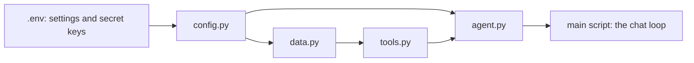

# Lesson 3.1: Modules, Packages and Secrets

**Course:** Python for AI · **Module 3:** RAG and Tools · **Updated:** Oct 2026

> **By the end:** You can split a growing app into your own modules and a package, import between them, keep API keys out of your code with a `.env` file, and switch your agent from a local model to a cloud model by changing one line of settings, not your code.

---

## 1. Mental Model: A Restaurant Kitchen Has Stations

A small cafe can cook everything at one table. A real restaurant has **stations**: one for drinks, one for the grill, one for desserts. Everyone knows where to find things, and the head chef keeps the safe keys in a locked drawer, not on the menu.



Your Module 2 agent is one long file. That is fine for 100 lines. At 300 lines it is hard to read, hard to test and impossible to share with a teammate.

| One big file | Modules and a package |
|---|---|
| Scroll for minutes to find a tool | `tools.py` holds the tools, nothing else |
| The API key is typed into the code | The key lives in `.env`, which never reaches GitHub |
| Changing the model means editing code | Change `MODEL=` in `.env`, run again |
| Two people editing one file = conflicts | Each person works on a different file |

---

## 2. Your Own Module: Any `.py` File You Import

A **module** is just a Python file. Create `code/pricing.py`:

```python
"""Pricing helpers for Sweet Crumbs: one place for every price rule."""

DELIVERY_FEE = 200
FREE_DELIVERY_FROM = 3000


def delivery_fee(subtotal: int) -> int:
    """Return the delivery fee for an order subtotal in PKR."""
    if subtotal >= FREE_DELIVERY_FROM:
        return 0
    return DELIVERY_FEE


def order_total(price: int, quantity: int) -> int:
    """Return the full order total in PKR, delivery included."""
    subtotal = price * quantity
    return subtotal + delivery_fee(subtotal)
```

Now use it from another file in the **same folder**, `code/lesson_3_1_imports.py`:

```python
"""Lesson 3.1: use code from your own file with import."""

import pricing
from pricing import order_total, FREE_DELIVERY_FROM
from pricing import delivery_fee as fee

print(pricing.delivery_fee(1000))   # 200
print(order_total(1500, 2))         # 3000
print(fee(5000))                    # 0
print(f"Free delivery from {FREE_DELIVERY_FROM:,} PKR")
```

| Style | Use it as | When |
|---|---|---|
| `import pricing` | `pricing.delivery_fee(...)` | Clear where each name comes from |
| `from pricing import order_total` | `order_total(...)` | You use a name often |
| `from pricing import delivery_fee as fee` | `fee(...)` | A shorter name, or two modules use the same name |

You have done this since Lesson 2.1: `from langchain.chat_models import init_chat_model` imports a name from **someone else's** module. Now you write your own.

**Import order (pro habit):** Python's own modules first (`json`, `os`), then installed packages (`langchain`), then your own modules, with a blank line between each group.

---

## 3. `if __name__ == "__main__":` Run Tests Only When You Mean To

When Python imports a file, it **runs the whole file once**. Test code at the bottom of `pricing.py` would run every time another file imports it. The fix:

```python
if __name__ == "__main__":
    # Runs only with `uv run pricing.py`, never when another file imports pricing
    assert delivery_fee(1000) == 200
    assert delivery_fee(3000) == 0
    assert order_total(250, 4) == 1200
    print("pricing.py: all tests passed")
```

```bash
uv run pricing.py             # pricing.py: all tests passed
uv run lesson_3_1_imports.py  # the tests do NOT run
```

| You run | `__name__` inside `pricing.py` is | Tests run? |
|---|---|---|
| `uv run pricing.py` | `"__main__"` | Yes |
| `import pricing` from another file | `"pricing"` | No |

**Rule:** a module defines things (constants, functions, tools). The script you run **does** things (the chat loop).

---

## 4. Packages: A Folder of Modules

When you have several modules for one app, put them in a folder with an `__init__.py` file. That folder is a **package**.

```text
code/
├── business.json
├── lesson_3_1_agent.py        the script you run: the chat loop
└── sweet_crumbs/              the package
    ├── __init__.py            marks the folder as a package (a docstring is enough)
    ├── config.py              settings from .env
    ├── data.py                loads and saves business.json
    ├── tools.py               the agent's tools
    └── agent.py               the model and the agent loop
```

Import with the package name and a dot:

```python
from sweet_crumbs.tools import TOOLS
from sweet_crumbs.agent import run_agent
```

| Word | Meaning |
|---|---|
| **Module** | One `.py` file |
| **Package** | A folder of modules with an `__init__.py` |
| **Library** | A package someone published, installed with `uv add` (LangChain is one) |

**Run the script from outside the package.** `uv run lesson_3_1_agent.py` works. `uv run sweet_crumbs/tools.py` fails with `ModuleNotFoundError: No module named 'sweet_crumbs'`, because Python looks for packages next to the script it runs. To run a module inside a package on its own, use `uv run python -m sweet_crumbs.tools` from the `code` folder.

---

## 5. Secrets: API Keys Live in `.env`, Never in Code

Cloud models need an **API key**: a password that charges **your** account. A key pushed to a public GitHub repo can be found by bots within minutes and used to run up a bill.

**Step 1: install the reader**

```bash
uv add python-dotenv
```

**Step 2: create `.env` in the project root** (next to `pyproject.toml`)

```text
PROVIDER=ollama
MODEL=llama3.2
ANTHROPIC_API_KEY=
```

**Step 3: never commit it.** Add one line to `.gitignore`:

```text
.env
```

**Step 4: commit a safe template instead.** Create `.env.example` with the same names and **no real values**, so a teammate or client knows what to fill in:

```text
# Copy this file to .env and fill in your own values. Never commit .env.
PROVIDER=ollama
MODEL=llama3.2
ANTHROPIC_API_KEY=
```

**Step 5: read the values in Python** (`code/lesson_3_1_env.py`):

```python
"""Lesson 3.1: read settings and secrets from .env."""

import os

from dotenv import load_dotenv

load_dotenv()  # reads .env and puts each line into the environment

provider = os.getenv("PROVIDER", "ollama")
model = os.getenv("MODEL", "llama3.2")
api_key = os.getenv("ANTHROPIC_API_KEY", "")

print(f"Provider: {provider}, model: {model}")
if api_key == "":
    print("No API key set")
else:
    print(f"API key loaded: {api_key[:7]}... ({len(api_key)} characters)")  # never print the whole key
```

| Part | What it does |
|---|---|
| `load_dotenv()` | Finds `.env` (it searches upwards from your script's folder) and loads it |
| `os.getenv("MODEL", "llama3.2")` | Reads one setting, with a default if it is missing (like `.get()` in Lesson 2.3) |
| Values are always `str` | Convert numbers yourself: `int(os.getenv("MAX_STEPS", "5"))` |
| A real environment variable wins | If the server already has `MODEL` set, `.env` does not overwrite it. That is how apps run with different settings on a laptop and on a server |

**Never print, log or paste a full key.** Not in screenshots, not in WhatsApp, not in a question to an AI tool. If a key leaks, delete it in the provider's dashboard and create a new one.

---

## 6. One Setting, Any Model

LangChain's `init_chat_model` already takes the model and the provider as text. Read both from `.env`, and your code never changes:

```python
from langchain.chat_models import init_chat_model

llm = init_chat_model(MODEL, model_provider=PROVIDER, temperature=0.2)
```

**Switch to a cloud model (optional, needs an account and a paid key):**

```bash
uv add langchain-anthropic
```

```text
PROVIDER=anthropic
MODEL=claude-haiku-5-5
ANTHROPIC_API_KEY=your-key-here
```

Run the same script again. Nothing else changes. LangChain reads `ANTHROPIC_API_KEY` from the environment by itself. Model names change over time, so check the provider's model list for the current one.

| Choose | When |
|---|---|
| **Local** (`ollama`) | Learning, private client data, no budget, offline |
| **Cloud** (`anthropic`, `openai`, `google_genai` ...) | Better answers and tool use, faster on weak laptops, the client pays per token |

**Pro move: fail early with a clear message.** A missing key otherwise shows up as a confusing error on the first question:

```python
if PROVIDER == "anthropic" and os.getenv("ANTHROPIC_API_KEY", "") == "":
    raise SystemExit("PROVIDER is anthropic but ANTHROPIC_API_KEY is empty. Add it to your .env file.")
```

---

## 7. Mini Build: The Lesson 2.8 Agent, Organised

Same agent, same tools, now split into stations. Create the `sweet_crumbs` folder inside `code/` and build it file by file.

**`code/business.json`** (the owner edits data, not code: Lesson 2.6)

```json
{
  "name": "Sweet Crumbs",
  "city": "Lahore",
  "prices": {"chocolate cake": 1500, "cupcake": 250, "brownie": 300},
  "orders": {"A101": "baking", "A102": "out for delivery", "A103": "delivered"}
}
```

**`code/sweet_crumbs/__init__.py`**

```python
"""Sweet Crumbs AI agent: settings, data, tools and the agent loop."""
```

**`code/sweet_crumbs/config.py`**: every setting in one place

```python
"""Settings for the whole app, read once from .env."""

import os
from pathlib import Path

from dotenv import load_dotenv

load_dotenv()

PROVIDER = os.getenv("PROVIDER", "ollama")
MODEL = os.getenv("MODEL", "llama3.2")
MAX_STEPS = int(os.getenv("MAX_STEPS", "5"))

# The data file sits next to this package, so the app works from any folder
DATA_FILE = Path(__file__).parent.parent / "business.json"

# Fail early with a clear message instead of a confusing error on the first question
if PROVIDER == "anthropic" and os.getenv("ANTHROPIC_API_KEY", "") == "":
    raise SystemExit("PROVIDER is anthropic but ANTHROPIC_API_KEY is empty. Add it to your .env file.")
```

`Path(__file__).parent.parent` means "the folder above the folder this file is in", which is `code/`. **Copy it for now:** Lesson 3.4 explains `pathlib`.

**`code/sweet_crumbs/data.py`**: load and save the business data

```python
"""Business data: loaded from business.json, saved back after changes."""

import json

from sweet_crumbs.config import DATA_FILE

try:
    with open(DATA_FILE, encoding="utf-8") as f:
        business = json.load(f)
except FileNotFoundError:
    raise SystemExit(f"Missing {DATA_FILE}. Create it first.")

PRICES = business["prices"]
ORDERS = business["orders"]


def save():
    """Save the business data, including new orders, back to the file."""
    with open(DATA_FILE, "w", encoding="utf-8") as f:
        json.dump(business, f, indent=2, ensure_ascii=False)
```

**`code/sweet_crumbs/tools.py`**: the three tools from Lesson 2.8

```python
"""The agent's tools: read prices, check orders, place orders with approval."""

from langchain.tools import tool

from sweet_crumbs.data import ORDERS, PRICES, save


@tool(parse_docstring=True)
def get_price(item: str) -> str:
    """Get the price of one bakery item.

    Args:
        item: The item name, for example "cupcake".
    """
    name = item.lower().strip()
    if name in PRICES:
        return f"{name} costs {PRICES[name]} PKR"
    return f"{item} is not on the menu. Menu: {', '.join(PRICES)}"


@tool(parse_docstring=True)
def order_status(order_id: str) -> str:
    """Check the delivery status of an existing order.

    Args:
        order_id: The order number, for example "A101".
    """
    key = order_id.upper().strip()
    if key not in ORDERS:
        return f"Order {order_id} not found"
    return f"Order {key} is {ORDERS[key]}"


@tool(parse_docstring=True)
def place_order(item: str, quantity: int, customer: str) -> str:
    """Place a new order. Only use this when the customer clearly asks to order.

    Args:
        item: The item name, for example "cupcake".
        quantity: How many, for example 2.
        customer: The customer's name.
    """
    name = item.lower().strip()
    if name not in PRICES:
        return f"{item} is not on the menu"
    total = PRICES[name] * int(quantity)
    answer = input(f"  [approve] {quantity} x {name} for {customer} = {total} PKR. Place it? (yes/no) ")
    if answer.strip().lower() != "yes":
        return "The owner did not approve this order"
    order_id = f"A{101 + len(ORDERS)}"
    ORDERS[order_id] = "received"
    save()
    return f"Order {order_id} placed: {quantity} x {name}, total {total} PKR"


TOOLS = {"get_price": get_price, "order_status": order_status, "place_order": place_order}
```

**`code/sweet_crumbs/agent.py`**: the model and the agent loop

```python
"""The agent loop: let the model call tools until it is ready to answer."""

from langchain.chat_models import init_chat_model
from pydantic import ValidationError

from sweet_crumbs.config import MAX_STEPS, MODEL, PROVIDER
from sweet_crumbs.tools import TOOLS

# One line decides local or cloud: the rest of the app never changes
llm = init_chat_model(MODEL, model_provider=PROVIDER, temperature=0.2)
llm_with_tools = llm.bind_tools(list(TOOLS.values()))


def run_agent(messages: list) -> str:
    """Run the agent loop on the chat so far and return the final answer."""
    for step in range(MAX_STEPS):
        response = llm_with_tools.invoke(messages)
        messages.append(response)

        if not response.tool_calls:
            return response.text

        for call in response.tool_calls:
            name = call["name"]
            args = call["args"]
            if name not in TOOLS:
                result = f"Unknown tool: {name}"
            else:
                try:
                    result = TOOLS[name].invoke(args)
                except ValidationError:
                    result = f"Tool error: wrong arguments {args}. Check the tool's Args."
            print(f"  [tool] {name}({args}) -> {result}")
            messages.append({"role": "tool", "content": result, "tool_call_id": call["id"]})
    else:
        return "Sorry, I could not finish that. A human will help you."
```

**`code/lesson_3_1_agent.py`**: the script you run is now short

```python
"""Lesson 3.1: the Sweet Crumbs agent, organised as a package. Run: uv run lesson_3_1_agent.py"""

from sweet_crumbs.agent import run_agent
from sweet_crumbs.config import MODEL, PROVIDER
from sweet_crumbs.data import business

messages = [{
    "role": "system",
    "content": f"You are the {business['name']} bakery agent in {business['city']}. "
    "Use the tools for prices, order status and new orders. Never guess. Answer in 2 short lines.",
}]

print(f"{business['name']} Agent ({PROVIDER}: {MODEL}). Type 'bye' to exit.")

while True:
    text = input("You: ").strip()
    if text.lower() == "bye":
        break
    if text == "":
        continue
    messages.append({"role": "user", "content": text})
    print(f"Agent: {run_agent(messages)}")
```

```bash
cd code
uv run lesson_3_1_agent.py
```

**Try it in class:**
1. Ask `Compare the price of a brownie and a cupcake` and watch the two `[tool]` lines
2. Place an order, approve it, then open `business.json`: the new order is saved
3. Change `MODEL=llama3.2` to `MODEL=llama3.2:1b` in `.env` and run again. Which model chose the tools better? You changed **zero** lines of Python
4. Open `git status`: `.env` must **not** appear. `.env.example` must

---

## 8. Common Errors and Traps

| Problem | Cause | Fix |
|---|---|---|
| `ModuleNotFoundError: No module named 'pricing'` | You ran the script from another folder, or the file name is different | Run from the folder that holds `pricing.py`, check the spelling |
| `ModuleNotFoundError: No module named 'sweet_crumbs'` | You ran a file **inside** the package directly | Run the main script, or `uv run python -m sweet_crumbs.tools` from `code/` |
| `ModuleNotFoundError: No module named 'dotenv'` | Package not installed | `uv add python-dotenv` (the import name is `dotenv`) |
| `ImportError: cannot import name 'TOOLS' from 'sweet_crumbs.tools'` | Typo in the name, or the name is defined further down than you think | Check the spelling and that the name exists at the top level of the module |
| `ImportError: cannot import name 'X' from 'a'`, but `X` **is** in `a.py` | A **circular import**: `a.py` imports `b.py` and `b.py` imports `a.py`, so one of them is only half loaded | Move the shared code into a third module (that is why `config.py` imports nothing of yours) |
| `AttributeError: module 'json' has no attribute 'load'` | You named your own file `json.py`, so it hides the real one | Never name files after real modules: `json.py`, `langchain.py`, `ollama.py`, `random.py` |
| `os.getenv` returns `None` or your default | `.env` not found, a typo in the name, or `load_dotenv()` not called | Check the file is called exactly `.env`, check the name, call `load_dotenv()` before `os.getenv` |
| `TypeError: Anthropic authentication failed: no API key ...` | Cloud provider chosen but no key in the environment | Add the key to `.env`; the early `SystemExit` check catches this |
| `ImportError: Initializing ChatOpenAI requires the langchain-openai package` | Each cloud provider needs its own package | `uv add langchain-openai` (or `langchain-anthropic`, `langchain-google-genai`) |
| `ValueError: Unsupported provider='olama'` | Typo in `PROVIDER` | Fix the spelling in `.env` |
| `.env` shows in `git status` | `.gitignore` is missing the line | Add `.env`; if it was already committed, run `git rm --cached .env` and **create a new key** |

---

## 9. Job & Client Angle

- **Handover-ready code.** A client's developer opens your repo and sees `config.py`, `tools.py`, `.env.example` and a short main script. That is code they trust and pay to extend.
- **Security is a hiring filter.** "Never commit secrets, use `.env` and `.env.example`" is asked in interviews and checked in code reviews. One leaked key can cost a client real money.
- **Provider-agnostic is a selling point.** "It runs on a free local model for your private data, and on a cloud model with one setting when you need more power" wins proposals.

---

## 10. Your Task (self-create)

Reorganise **your own** Lesson 2.8 agent into a package in `code/`: a `config.py` that reads `.env`, separate modules for data, tools and the agent loop, a short main script, a module with `if __name__ == "__main__":` tests, and a committed `.env.example` (never `.env`).

**Full requirements, expected output, stretch goal and marking:** [Task 3.1: Organised Agent](../assessments/module-3/checkpoint-1-code-tasks.md#task-31-organised-agent)

Run it with `uv run lesson_3_1_agent.py` from the `code` folder, check that `.env` is not in `git status`, then push.

---

## Key Takeaways

- A **module** is a `.py` file; a **package** is a folder of modules with an `__init__.py`
- Modules **define** things; the script you run **does** things. `if __name__ == "__main__":` keeps tests out of imports
- Secrets and settings live in `.env`, read with `load_dotenv()` and `os.getenv()`; commit `.env.example`, never `.env`
- `init_chat_model(MODEL, model_provider=PROVIDER)` + `.env` = switch local or cloud with zero code changes
- Never name a file after a real module, and never let two modules import each other

### Quick Check
1. What is the difference between a module and a package?
2. Why does test code go under `if __name__ == "__main__":`?
3. Your `.env` was pushed to GitHub by mistake. What are the two things you must do?

---

## Must-Have Resources

- Python tutorial, modules and packages: https://docs.python.org/3/tutorial/modules.html
- `__main__`: top-level code: https://docs.python.org/3/library/__main__.html
- python-dotenv: https://pypi.org/project/python-dotenv/
- LangChain models and providers (`init_chat_model`): https://docs.langchain.com/oss/python/langchain/models
- GitHub: remove sensitive data from a repository: https://docs.github.com/en/authentication/keeping-your-account-and-data-secure/removing-sensitive-data-from-a-repository

**Next:** Lesson 3.2: Classes and Pydantic Models
