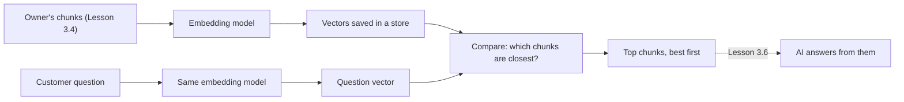

# Lesson 3.5: Embeddings and Semantic Search

**Course:** Python for AI · **Module 3:** RAG and Tools · **Updated:** Oct 2026

> **By the end:** You can work with lists of numbers using `zip`, `sum` and `math`, rank results with `sorted(key=...)`, and explain **embeddings**: text turned into numbers that capture meaning. You compare them by hand first, then with LangChain's built-in vector store, and give your agent a search that finds "Can I get my money back?" in a policy that only says "refund".

---

## 1. Mental Model: A Map of Meaning

Imagine a huge map where every sentence has a place. Sentences that **mean** the same thing sit close together, even if they share no words. "Can I get my money back?" sits next to "Refunds within 24 hours". "Fresh brownies every morning" sits far away, in the food corner.

An **embedding** is a sentence's coordinates on that map: a list of numbers. A real embedding model uses hundreds of numbers (768 for `nomic-embed-text`), not two, but the idea is the same.



| Word | Meaning |
|---|---|
| **Vector** | A list of numbers, like `[0.9, 0.1, 0.0]` |
| **Embedding** | A vector made by a model so that similar meanings get similar numbers |
| **Embedding model** | A small model that only makes vectors; it never writes text |
| **Similarity score** | How close two vectors point: near 1 means same meaning, near 0 means unrelated |
| **Vector store** | A place that keeps every chunk with its vector and finds the closest ones fast |
| **Semantic search** | Search by meaning instead of exact words |

**Why this matters:** Lesson 3.4's keyword search missed "money back" because the policy says "refund". Customers never use the owner's words. Search by meaning fixes that.

---

## 2. Vectors by Hand: Lists of Numbers and `zip`

Before any model, make tiny "embeddings" yourself. Give each sentence 3 scores between 0 and 1: **[about money, about food, about delivery]**.

| Sentence | money | food | delivery |
|---|---|---|---|
| Can I get my money back? | 0.95 | 0.05 | 0.0 |
| Refunds are given within 24 hours. | 0.9 | 0.1 | 0.1 |
| Fresh brownies are baked every morning. | 0.1 | 0.9 | 0.0 |
| Delivery is free from 3,000 PKR. | 0.4 | 0.0 | 0.9 |

To compare two vectors you walk through them **side by side**: the first number with the first, the second with the second. `zip` does exactly that: it pairs up items from two lists.

```text
>>> list(zip([1, 2, 3], ["a", "b", "c"]))
[(1, 'a'), (2, 'b'), (3, 'c')]
>>> question = [0.95, 0.05, 0.0]
>>> refund = [0.9, 0.1, 0.1]
>>> [x * y for x, y in zip(question, refund)]
[0.855, 0.005000000000000001, 0.0]
```

Add those products up and you have the **dot product**: big when both vectors are high in the same places. (The long `0.005000000000000001` is normal: computers store decimals with tiny rounding errors. Round when you print.)

---

## 3. A Little Maths: Cosine Similarity

The dot product alone has a problem: a long sentence with big numbers everywhere scores high against everything. So we divide by each vector's **length**, and only the **direction** counts. That is **cosine similarity**.

| Step | Code | In words |
|---|---|---|
| Dot product | `sum(x * y for x, y in zip(a, b))` | Multiply matching numbers, add them up |
| Length | `math.sqrt(sum(x * x for x in a))` | Pythagoras, in any number of dimensions |
| Cosine | `dot(a, b) / (length(a) * length(b))` | 1 = same direction (meaning), 0 = unrelated |

You do not need to prove the formula. You need to know: **higher means closer in meaning**, and the score is between -1 and 1 (for text, usually 0 to 1).

---

## 4. Ranking with `sorted(key=...)`

`sorted()` sorts numbers and words on its own, but a list of `(text, score)` pairs needs to be told **what** to sort by. `key=` takes a function that picks the sort value from each item.

`code/lesson_3_5_vectors.py`

```python
"""Lesson 3.5: meaning as numbers, by hand: compare tiny 3-number "embeddings" with cosine similarity."""

import math

# Hand-made scores for 3 ideas: [about money, about food, about delivery]
sentences = {
    "Refunds are given within 24 hours.": [0.9, 0.1, 0.1],
    "Fresh brownies are baked every morning.": [0.1, 0.9, 0.0],
    "Delivery is free from 3,000 PKR.": [0.4, 0.0, 0.9],
}
question = "Can I get my money back?"
question_vector = [0.95, 0.05, 0.0]


def dot(a: list, b: list) -> float:
    """Multiply matching numbers and add them up: big when both point the same way."""
    return sum(x * y for x, y in zip(a, b))


def length(a: list) -> float:
    """The length of a vector (Pythagoras, in any number of dimensions)."""
    return math.sqrt(sum(x * x for x in a))


def cosine(a: list, b: list) -> float:
    """Cosine similarity: 1 = same meaning, 0 = unrelated. Length does not matter, only direction."""
    return dot(a, b) / (length(a) * length(b))


print(list(zip([1, 2, 3], ["a", "b", "c"])))   # [(1, 'a'), (2, 'b'), (3, 'c')]

scores = [(text, cosine(question_vector, vector)) for text, vector in sentences.items()]


def by_score(pair: tuple) -> float:
    """The sort key: the score part of a (text, score) pair."""
    return pair[1]


ranked = sorted(scores, key=by_score, reverse=True)
print(f"Question: {question}")
for text, score in ranked:
    print(f"  {score:.2f}  {text}")

# The same sort with a lambda: a tiny function written in one line
ranked = sorted(scores, key=lambda pair: pair[1], reverse=True)
print("Best match:", ranked[0][0])
```

**Output**
```text
[(1, 'a'), (2, 'b'), (3, 'c')]
Question: Can I get my money back?
  0.99  Refunds are given within 24 hours.
  0.41  Delivery is free from 3,000 PKR.
  0.16  Fresh brownies are baked every morning.
Best match: Refunds are given within 24 hours.
```

| Part | Why |
|---|---|
| `zip(a, b)` | Walks two lists side by side, pair by pair |
| `sum(x * y for ...)` | A generator inside `sum`: like a list comprehension without the `[ ]` |
| `math.sqrt` | Square root, from Python's built-in `math` module |
| `key=by_score` | Pass the **function itself** (no brackets): `sorted` calls it on every pair |
| `lambda pair: pair[1]` | The same function in one line, with no name. Use it for tiny keys only |
| `reverse=True` | Highest score first |
| `ranked[0][0]` | First pair, then the text inside it |

Notice the question and "Refunds..." share **no words**, but their numbers point the same way. A real embedding model does this scoring for you, for hundreds of ideas you never named.

**Try it in class:** add the sentence `"Our shop opens at 9 am."` with your own 3 scores. Where does it rank? What fourth number (dimension) would you need to describe it well?

---

## 5. Real Embeddings from a Local Model

### Setup

```bash
ollama pull nomic-embed-text
uv add numpy
```

`nomic-embed-text` is a small (about 270 MB) model made **only** for embeddings. It runs on a laptop and keeps the owner's documents private. `numpy` is needed by LangChain's vector store in Section 6.

For Urdu or Roman Urdu documents, also try `ollama pull embeddinggemma` (Google's multilingual embedding model). You will compare both in your task.

`code/lesson_3_5_embeddings.py`

```python
"""Lesson 3.5: real embeddings from a local model: compare a question with sentences by meaning."""

import math

from langchain.embeddings import init_embeddings

# A small model made only for embeddings: ollama pull nomic-embed-text
embeddings = init_embeddings("nomic-embed-text", provider="ollama")

vector = embeddings.embed_query("Can I get my money back?")
print(f"{len(vector)} numbers, starting with {[round(x, 3) for x in vector[:4]]}")


def cosine(a: list, b: list) -> float:
    """Cosine similarity: 1 = same meaning, 0 = unrelated."""
    dot = sum(x * y for x, y in zip(a, b))
    return dot / (math.sqrt(sum(x * x for x in a)) * math.sqrt(sum(y * y for y in b)))


sentences = [
    "If your order is wrong or late, call us within 24 hours for a full refund.",
    "Fresh brownies are baked every morning.",
    "Delivery inside Lahore costs 200 PKR.",
    "Orders for 20 people or more need 3 days notice.",
]
# embed_documents does many texts in one call: faster than one call per sentence
sentence_vectors = embeddings.embed_documents(sentences)

for question in ["Can I get my money back?", "How early must I book a party?"]:
    question_vector = embeddings.embed_query(question)
    scores = [(cosine(question_vector, v), s) for v, s in zip(sentence_vectors, sentences)]
    print(f"\n{question}")
    for score, sentence in sorted(scores, reverse=True)[:2]:
        print(f"  {score:.2f}  {sentence}")
```

**Output (example: your numbers will differ, the order is what matters)**
```text
768 numbers, starting with [...4 small numbers...]

Can I get my money back?
  0.34  If your order is wrong or late, call us within 24 hours for a full refund.
  0.04  Fresh brownies are baked every morning.

How early must I book a party?
  0.82  Orders for 20 people or more need 3 days notice.
  0.10  If your order is wrong or late, call us within 24 hours for a full refund.
```

| Part | Why |
|---|---|
| `init_embeddings("nomic-embed-text", provider="ollama")` | The embeddings twin of `init_chat_model` (Lesson 2.1): change the model or provider, not the code |
| `embed_query(text)` | One text in, one vector out |
| `embed_documents(list)` | Many texts in one call, one vector each: much faster than a loop of `embed_query` |
| Our own `cosine` | The same maths as Section 3, now on 768 numbers |
| `zip(sentence_vectors, sentences)` | Keeps each vector next to its sentence |
| `sorted(scores, reverse=True)[:2]` | Tuples sort by their first item, the score, so no `key=` is needed here |

**Scores from real models are often bunched together.** With `nomic-embed-text`, even unrelated sentences can score 0.4 or more, so your numbers may look very different from the example. That is normal. The **ranking** is what you trust, and in Section 7 you will measure where "unrelated" starts for your own documents.

---

## 6. LangChain's Built-in Vector Store

Comparing every chunk with a loop works for 4 sentences. For hundreds of chunks you want a store that keeps each chunk, its metadata and its vector together, and returns the closest ones. LangChain's `InMemoryVectorStore` does that with no database to install.

`code/lesson_3_5_vector_store.py` (uses `chunks.json` from Lesson 3.4)

```python
"""Lesson 3.5: LangChain's in-memory vector store: index the Lesson 3.4 chunks and search them by meaning."""

import json

from langchain.embeddings import init_embeddings
from langchain_core.documents import Document
from langchain_core.vectorstores import InMemoryVectorStore

embeddings = init_embeddings("nomic-embed-text", provider="ollama")
store = InMemoryVectorStore(embeddings)

# chunks.json comes from Lesson 3.4: every chunk with its text, source and page
with open("chunks.json", encoding="utf-8") as f:
    rows = json.load(f)
documents = [Document(page_content=row["text"], metadata={k: v for k, v in row.items() if k != "text"}) for row in rows]
store.add_documents(documents)  # every chunk is embedded here: one call to the model
print(f"Indexed {len(documents)} chunks")


def preview(document: Document) -> str:
    """The first 70 characters of a chunk, on one line."""
    return " ".join(document.page_content.split())[:70]


for question in ["Can I get my money back?", "Is there anything without nuts?", "Who won the cricket match?"]:
    print(f"\n{question}")
    for document, score in store.similarity_search_with_score(question, k=2):
        print(f"  {score:.2f}  [{document.metadata['source']}] {preview(document)}...")
```

**Output (example: your numbers will differ)**
```text
Indexed 5 chunks

Can I get my money back?
  0.43  [policies.md] # Sweet Crumbs Policies ## Opening hours We are open 9 am to 10 pm, ev...
  0.22  [catering.pdf] Packages Party Box (20 cupcakes and 10 brownies): 7,500 PKR. Office Bo...

Is there anything without nuts?
  0.87  [policies.md] ## Allergies All products are made in a kitchen that uses nuts, eggs, ...
  0.12  [menu.txt] SWEET CRUMBS MENU (updated October 2026) Chocolate cake 1,500 PKR Rich...

Who won the cricket match?
  0.03  [policies.md] # Sweet Crumbs Policies ## Opening hours We are open 9 am to 10 pm, ev...
  0.03  [catering.pdf] Packages Party Box (20 cupcakes and 10 brownies): 7,500 PKR. Office Bo...
```

| Part | Why |
|---|---|
| `InMemoryVectorStore(embeddings)` | The store knows which model to use for chunks **and** questions, so both are always made the same way |
| `store.add_documents(documents)` | Embeds every chunk and keeps it with its metadata |
| `similarity_search_with_score(q, k=2)` | Embeds the question, returns the 2 closest `(Document, score)` pairs, best first. The score is cosine similarity |
| `similarity_search(q, k=2)` | The same without scores, when you only need the chunks |
| `document.metadata["source"]` | The source from Lesson 3.4 survives, so answers can cite it |

**Read the cricket line carefully.** A vector store **always** returns `k` results, even when nothing is relevant. Something must decide "too far away to count". That is the minimum score in the Mini Build.

The first policies chunk covers hours, delivery **and** refunds, so it wins for "money back". Smaller, one-topic chunks (Lesson 3.4) give cleaner matches.

---

## 7. Mini Build: Search by Meaning for the Agent

Four upgrades to the package: settings, a `search.py` module, the `search_documents` tool, and a search script.

### Step 1: add to `code/sweet_crumbs/config.py` (above the web API settings)

```python
# Search by meaning: the embedding model, where the index is saved, and how strict a match must be
EMBED_PROVIDER = os.getenv("EMBED_PROVIDER", "ollama")
EMBED_MODEL = os.getenv("EMBED_MODEL", "nomic-embed-text")
INDEX_FILE = Path(__file__).parent.parent / "index.json"
TOP_K = int(os.getenv("TOP_K", "3"))
MIN_SCORE = float(os.getenv("MIN_SCORE", "0.3"))
```

Add the same names to `.env.example`. Add `code/index.json` to `.gitignore` if the documents are private: the index contains their full text.

### Step 2: `code/sweet_crumbs/search.py`

```python
"""Search by meaning: embed the owner's chunks once, save the index, and find the best chunks for a question."""

import time

from langchain.embeddings import init_embeddings
from langchain_core.documents import Document
from langchain_core.vectorstores import InMemoryVectorStore

from sweet_crumbs.config import EMBED_MODEL, EMBED_PROVIDER, INDEX_FILE, KNOWLEDGE_DIR, MIN_SCORE, TOP_K
from sweet_crumbs.loader import load_folder, split_documents

embeddings = init_embeddings(EMBED_MODEL, provider=EMBED_PROVIDER)

# Reading and splitting files is fast, so it runs every start. Embedding is the slow part.
documents, SKIPPED = load_folder()
CHUNKS = split_documents(documents)


def index_is_fresh() -> bool:
    """True if the saved index is newer than every file in the knowledge folder."""
    if not INDEX_FILE.exists():
        return False
    newest = max((path.stat().st_mtime for path in KNOWLEDGE_DIR.glob("*")), default=0)
    return INDEX_FILE.stat().st_mtime > newest


def build_store() -> InMemoryVectorStore:
    """Load the saved index if it is fresh, otherwise embed every chunk and save the result."""
    if index_is_fresh():
        return InMemoryVectorStore.load(str(INDEX_FILE), embeddings)
    start = time.time()
    store = InMemoryVectorStore(embeddings)
    store.add_documents(CHUNKS)
    store.dump(str(INDEX_FILE))  # saved with the vectors, so the next start skips the embedding step
    print(f"(Built the search index: {len(CHUNKS)} chunks in {time.time() - start:.1f} seconds)")
    return store


store = build_store()


def search(question: str, k: int = TOP_K) -> list[tuple[Document, float]]:
    """Return up to k (chunk, score) pairs, best first, leaving out weak matches below MIN_SCORE."""
    results = store.similarity_search_with_score(question, k=k)
    return [(document, score) for document, score in results if score >= MIN_SCORE]


def preview(document: Document, size: int = 70) -> str:
    """The first characters of a chunk on one line, for printing."""
    return " ".join(document.page_content.split())[:size]


if __name__ == "__main__":
    for question in ["Can I get my money back?", "Who won the cricket match?"]:
        print(question)
        for document, score in search(question):
            print(f"  {score:.2f}  [{document.metadata['source']}] {preview(document)}...")
```

| Part | Why |
|---|---|
| `load_folder()` and `split_documents()` from Lesson 3.4 | The same chunks, reused; no copy of the loading code |
| `index_is_fresh()` | Compares file times: if the owner changes a file, the index is rebuilt automatically |
| `store.dump(...)` / `InMemoryVectorStore.load(...)` | Saves the vectors to a JSON file and loads them back. Embedding 1,000 chunks can take minutes; loading takes a moment |
| `MIN_SCORE` filter | Weak matches are dropped, so the agent can honestly say "I do not know" |
| `preview()` | `" ".join(text.split())` turns new lines into single spaces for a tidy one-line print |
| `CHUNKS` and `SKIPPED` | Kept as module names, so the project's `/docs` report still works |

**Test the module on its own:**
```bash
uv run python -m sweet_crumbs.search
```
```text
(Built the search index: 5 chunks in 0.0 seconds)
Can I get my money back?
  0.43  [policies.md] # Sweet Crumbs Policies ## Opening hours We are open 9 am t...
Who won the cricket match?
```

Run it again: no "Built" line, because the saved index is fresh.

### Step 3: `code/sweet_crumbs/docs_tools.py`

If you built the Checkpoint 1 project, this **replaces** the keyword search. If not, create it and add `search_documents` to `TOOLS` in `tools.py`. The tool's name and docstring stay the same, so the agent loop (Lesson 2.8) does not change at all.

```python
"""The search_documents tool: answers from the owner's documents, found by meaning (Lesson 3.5).

Lesson 3.4's keyword search missed "money back" because the policy says "refund".
Search by meaning finds it, because the two have similar embeddings.
"""

from langchain.tools import tool

from sweet_crumbs.search import CHUNKS, SKIPPED, search  # CHUNKS and SKIPPED for the /docs report


@tool(parse_docstring=True)
def search_documents(question: str) -> str:
    """Search the owner's documents (menu, policies, catering guide) for rules, policies and details.

    Args:
        question: The customer's question, for example "can I get my money back".
    """
    results = search(question)
    if len(results) == 0:
        return "Nothing in the owner's documents matches that question. Say you do not know."
    lines = []
    for document, score in results:
        label = document.metadata["source"]
        if "page" in document.metadata:
            label += f", page {document.metadata['page']}"
        lines.append(f"[{label}] {document.page_content}")
    return "\n".join(lines)
```

### Step 4: `code/lesson_3_5_search.py`

```python
"""Lesson 3.5: search the owner's documents by meaning. Run: uv run lesson_3_5_search.py"""

from sweet_crumbs.config import EMBED_MODEL, MIN_SCORE, TOP_K
from sweet_crumbs.search import preview, search, store

print(f"Search by meaning ({EMBED_MODEL}): {len(store.store)} chunks, top {TOP_K}, minimum score {MIN_SCORE}")
print("Ask a question about the business, or type bye.")

while True:
    question = input("Search: ").strip()
    if question.lower() == "bye":
        break
    if question == "":
        continue
    results = search(question)
    if len(results) == 0:
        print("  Nothing relevant found. (The agent will say it does not know.)")
    for document, score in results:
        bar = "#" * round(score * 20)  # a quick picture of how close the meaning is
        print(f"  {score:.2f} {bar:<20} [{document.metadata['source']}] {preview(document)}...")
```

**Run**
```bash
uv run lesson_3_5_search.py
```

**Output (example: your numbers will differ)**
```text
Search by meaning (nomic-embed-text): 5 chunks, top 3, minimum score 0.3
Ask a question about the business, or type bye.
Search: Can I get my money back?
  0.43 #########            [policies.md] # Sweet Crumbs Policies ## Opening hours We are open 9 am to 10 pm, ev...
Search: Who won the cricket match?
  Nothing relevant found. (The agent will say it does not know.)
Search: bye
```

### Step 5: calibrate `MIN_SCORE` for your documents

The right minimum depends on the model and the documents, so **measure it**:

1. Ask 3 questions the documents **do** answer, in customer words ("money back", "nut free", "party for 25 people"). Write down the score of the right chunk
2. Ask 3 questions they **do not** answer ("cricket score", "fix my laptop", "weather in Karachi"). Write down the best score
3. Set `MIN_SCORE` in `.env` between the two groups. With `nomic-embed-text` this is often around 0.5 to 0.6
4. If the two groups overlap, your chunks are too big or mix topics: try a smaller `CHUNK_SIZE`

### Step 6: run the agent

```bash
uv run project_m3_live_agent.py
```
**Example (the wording will differ)**
```text
You: Can I get my money back if my cake is late?
Agent: Yes. If your order is late by more than 1 hour, call within 24 hours for a full refund or a free replacement (policies.md).
```

In Lesson 3.4 this question found nothing. Same agent, same tool name, better search.

**Try it in class:**
1. Ask the same question in Roman Urdu ("paise wapas mil sakte hain?"). Does `nomic-embed-text` find the refund chunk? Switch `EMBED_MODEL=embeddinggemma` in `.env` and try again
2. Edit `policies.md`, run the search again: the "Built" line appears, because the index was out of date
3. Set `TOP_K=1`: what does the agent lose when the answer is spread over two chunks?

---

## 8. Common Errors and Traps

| Problem | Cause | Fix |
|---|---|---|
| `ImportError: cosine_similarity requires numpy to be installed` | `InMemoryVectorStore` needs `numpy` | `uv add numpy` |
| `ResponseError: model "nomic-embd" not found, try pulling it first (status code: 404)` | Typo, or the model is not downloaded | `ollama list`, then `ollama pull nomic-embed-text` |
| `httpx.ConnectError` on the first embed | Ollama is not running | Start the Ollama app or `ollama serve` |
| Using a chat model (`llama3.2`) for embeddings | It works, but the vectors are poor and slow | Use a model made for embeddings: `nomic-embed-text`, `embeddinggemma` |
| Good results yesterday, nonsense today | The index was built with one embedding model and questions use another | Every model has its own map: delete `index.json` after changing `EMBED_MODEL` |
| Every start is slow | Re-embedding every chunk each run | Save with `dump`, reload with `load` (Step 2) |
| Unrelated questions still get "answers" | A vector store always returns `k` results | Filter with a calibrated `MIN_SCORE` |
| All scores look alike (0.4 to 0.7) | Normal for many embedding models | Trust the ranking; calibrate the threshold on your data |
| `TypeError: '<' not supported between instances of 'Document' and 'Document'` | Sorting `(score, Document)` pairs when two scores are equal: Python then compares the Documents | Sort by the score: `key=lambda pair: pair[1]` |
| `sorted(scores, key=by_score())` fails | Brackets call the function instead of passing it | `key=by_score`, no brackets |
| Exact codes and names not found ("order SC-1042") | Meaning search is weak on exact strings | Keep a keyword or lookup tool for IDs (like `order_status`) |

---

## 9. Job & Client Angle

- **Semantic search is the core of every RAG product** clients ask for: "a bot that knows our documents". You now understand the part most tutorials hide behind one line of code.
- **Explain it in the client's words:** "Customers ask in their own words. The search finds the right policy even when the words are different."
- **Measure, do not guess.** A short table of "question, expected chunk, score" (Step 5) is a professional test report and the start of evaluation work.
- **Local embeddings are private and free.** The owner's documents never leave the laptop. A cloud embedding model is a settings change later, but every document is then re-embedded.
- **Know the limits:** meaning search is weak on order numbers, phone numbers and product codes. Real systems combine it with keyword or database lookups, as your agent already does with its other tools.

---

## 10. Your Task (self-create)

Give **your own** business agent search by meaning: vectors compared by hand with `zip` and `sorted(key=...)`, then a `search.py` module with LangChain's vector store, a saved index, a calibrated minimum score, and the `search_documents` tool upgraded so customer words find the owner's policies.

**Full requirements, expected output, stretch goal and marking:** [Task 3.5: Semantic Search](../assessments/module-3/checkpoint-2-code-tasks.md#task-35-semantic-search)

Run it with `uv run lesson_3_5_search.py` from the `code` folder, then push (without private documents or `index.json`).

---

## Key Takeaways

- An **embedding** is a list of numbers that places text on a map of meaning; similar meaning, nearby numbers
- `zip` pairs lists side by side; `sum`, `math.sqrt` and a little maths give **cosine similarity**: higher means closer
- `sorted(items, key=function, reverse=True)` ranks anything; `lambda` is a one-line key
- `init_embeddings` + `InMemoryVectorStore` index chunks and return the closest ones with `similarity_search_with_score`
- Save the index, use the **same** embedding model for chunks and questions, and **calibrate** a minimum score so "not in the documents" stays an honest answer

### Quick Check
1. "Can I get my money back?" and "Refunds within 24 hours" share no words. Why does semantic search still match them?
2. What does `sorted(pairs, key=lambda pair: pair[1], reverse=True)` do, and why is `key=` needed?
3. Why does the search need a `MIN_SCORE`, and how do you choose its value?

---

## Must-Have Resources

- Python `zip`: https://docs.python.org/3/library/functions.html#zip
- Python sorting how-to (`key=` and `lambda`): https://docs.python.org/3/howto/sorting.html
- LangChain, build a knowledge base (embeddings and vector stores): https://docs.langchain.com/oss/python/langchain/knowledge-base#generate-embeddings
- LangChain vector stores: https://docs.langchain.com/oss/python/integrations/vectorstores/index
- Ollama `nomic-embed-text`: https://ollama.com/library/nomic-embed-text
- Ollama `embeddinggemma` (multilingual): https://ollama.com/library/embeddinggemma

**Next:** Lesson 3.6: RAG: Chat with Your Documents
