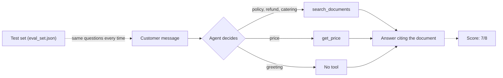

# Lesson 3.7: RAG as a Tool, and Evals

**Course:** Python for AI · **Module 3:** RAG and Tools · **Updated:** Oct 2026

> **By the end:** Document search is one tool in your Lesson 2.8 agent loop, and the agent decides **when** to search: policies yes, prices and greetings no. You save the search index to a file per embedding model, write fast automatic tests with **pytest**, and measure how good the answers are with a **test set** (an eval) that gives one score you can compare after every change.

---

## 1. Mental Model: A Shop Assistant and an Exam Paper

**The shop assistant.** In Lesson 3.6 every question went to the filing cabinet first, even "Hi!". A good shop assistant answers a greeting directly, checks the price list for prices, and opens the policy folder only for policy questions. That assistant is your agent, and the policy folder is now one of its tools.

**The exam paper.** How do you know the assistant is good? Not by asking two questions and smiling. You give the **same exam** every time: fixed questions, known right answers, one score. Change the prompt, the model or the chunk size, sit the exam again, compare the scores.



| Word | Meaning |
|---|---|
| **Unit test** | Checks one small function with known input and output, in milliseconds, with no model |
| **pytest** | Python's most used testing tool: finds `test_` functions and runs them |
| **Eval** | Runs the whole AI system on a fixed test set and gives a **score**, not just pass or fail |
| **Test set** | The questions, with what a good answer must contain or do |

---

## 2. RAG Pipeline or Agent Tool?

Both are RAG. The difference is **who decides to search**.

| | RAG pipeline (Lesson 3.6) | Agent with a search tool (this lesson) |
|---|---|---|
| Searches | On **every** question | Only when the model decides to |
| AI calls | 1 per question | 2 or more (the tool call, then the answer) |
| "I don't know" | Guaranteed by code when nothing is found | The tool returns the exact sentence; the model must use it |
| Can also price, order, convert | No | Yes |
| Best for | A documents help desk, an FAQ bot, a staff handbook | An all-in-one business assistant |
| Main risk | Wasted searches on "Hi!" | The model skips the search and guesses |

That last line is why this lesson also builds an eval: an agent's choices must be **measured**, not hoped for.

---

## 3. Saving the Search Index to a File

Lesson 3.5 saved the index with `dump()` and loaded it with `load()`. Two upgrades make it safe for a real project.

**Upgrade 1: one index file per embedding model and chunk size.** Vectors from `nomic-embed-text` mean nothing to `embeddinggemma` (Lesson 3.5, errors table). Put the model and chunk size in the **file name**, and switching either one simply uses, or builds, a different file. A mix-up becomes impossible.

Change the index settings in `code/sweet_crumbs/config.py`:

```python
# One index file per embedding model and chunk size: change either, and a new index is built
INDEX_DIR = Path(__file__).parent.parent / "indexes"
INDEX_NAME = f"{EMBED_MODEL}-{CHUNK_SIZE}".replace(":", "-").replace("/", "-")  # ":" is not allowed in Windows file names
INDEX_FILE = INDEX_DIR / f"{INDEX_NAME}.json"
```

Add `code/indexes/` to `.gitignore`: the files contain the owner's documents in full, and anyone can rebuild them.

**Upgrade 2: build or load on the first search, not on import.** In Lesson 3.5, `import sweet_crumbs.search` built the index straight away, so even a script that never searched needed Ollama. Tests must be fast and work offline, so the store now comes from a function that runs once.

`code/sweet_crumbs/search.py`

```python
"""Search by meaning: embed the owner's chunks once, save the index to a file, find the best chunks.

The index is built or loaded on the first search, not on import, so tests that
only import this package never need Ollama.
"""

import time
from functools import cache

from langchain.embeddings import init_embeddings
from langchain_core.documents import Document
from langchain_core.vectorstores import InMemoryVectorStore

from sweet_crumbs.config import EMBED_MODEL, EMBED_PROVIDER, INDEX_DIR, INDEX_FILE, KNOWLEDGE_DIR, MIN_SCORE, TOP_K
from sweet_crumbs.loader import load_folder, split_documents

# Reading and splitting files is fast and needs no model, so it runs on import
documents, SKIPPED = load_folder()
CHUNKS = split_documents(documents)


def index_is_fresh() -> bool:
    """True if the saved index is newer than every file in the knowledge folder."""
    if not INDEX_FILE.exists():
        return False
    newest = max((path.stat().st_mtime for path in KNOWLEDGE_DIR.glob("*")), default=0)
    return INDEX_FILE.stat().st_mtime > newest


@cache  # runs once; every later call returns the same store
def get_store() -> InMemoryVectorStore:
    """Load the saved index if it is fresh, otherwise embed every chunk and save the result."""
    embeddings = init_embeddings(EMBED_MODEL, provider=EMBED_PROVIDER)
    if index_is_fresh():
        return InMemoryVectorStore.load(str(INDEX_FILE), embeddings)
    start = time.time()
    store = InMemoryVectorStore(embeddings)
    store.add_documents(CHUNKS)
    INDEX_DIR.mkdir(exist_ok=True)
    store.dump(str(INDEX_FILE))
    print(f"(Built the search index {INDEX_FILE.name}: {len(CHUNKS)} chunks in {time.time() - start:.1f} seconds)")
    return store


def search(question: str, k: int = TOP_K) -> list[tuple[Document, float]]:
    """Return up to k (chunk, score) pairs, best first, leaving out weak matches below MIN_SCORE."""
    results = get_store().similarity_search_with_score(question, k=k)
    return [(document, score) for document, score in results if score >= MIN_SCORE]


def preview(document: Document, size: int = 70) -> str:
    """The first characters of a chunk on one line, for printing."""
    return " ".join(document.page_content.split())[:size]


if __name__ == "__main__":
    for question in ["Can I get my money back?", "Who won the cricket match?"]:
        print(question)
        for document, score in search(question):
            print(f"  {score:.2f}  [{document.metadata['source']}] {preview(document)}...")
```

| Part | Why |
|---|---|
| `@cache` on `get_store()` | From Python's `functools`: the first call builds or loads the store, every later call gets the same one instantly |
| `get_store().similarity_search_with_score(...)` | The store is created only when someone actually searches |
| `INDEX_DIR.mkdir(exist_ok=True)` | Creates `indexes/` the first time; no error if it exists |
| `CHUNKS` and `SKIPPED` still on import | Reading files needs no model, and the `/knowledge` report uses them |

If you kept `lesson_3_5_search.py`, change `store` to `get_store()` in its import and its first `print`.

---

## 4. Automatic Tests with pytest

Since Lesson 3.1 you tested modules with `assert` lines under `if __name__ == "__main__":`. That works for one file. **pytest** runs every test in the project with one command, shows exactly what failed, and is what every Python job uses.

### Setup

```bash
uv add --dev pytest
```

`--dev` means "for the developer only": the client's computer never needs it (like `ipykernel` in Lesson 1.3). Then add this to the end of `pyproject.toml` (in the project root):

```toml
[tool.pytest.ini_options]
pythonpath = ["code"]
testpaths = ["code/tests"]
markers = ["ollama: needs Ollama running with the embedding model"]
```

| Setting | Why |
|---|---|
| `pythonpath = ["code"]` | Lets tests `import sweet_crumbs` the same way your scripts do |
| `testpaths` | Where pytest looks for tests |
| `markers` | A label for slow tests that need Ollama, so you can skip them |

### The rules pytest follows

| Rule | Example |
|---|---|
| Test files start with `test_` | `code/tests/test_loader.py` |
| Test functions start with `test_` | `def test_page_footers_are_noise():` |
| A test passes if no `assert` fails and nothing crashes | `assert is_noise("Page 2 of 3")` |
| The name says what **should** happen | `test_a_normal_line_is_not_noise` reads like a sentence |

### First tests: `code/tests/test_loader.py`

```python
"""Unit tests for the document loader: fast, no model and no real documents needed."""

from sweet_crumbs.loader import clean_text, is_noise, load_folder


def test_page_footers_are_noise():
    assert is_noise("Page 2 of 3")
    assert is_noise("page 7")


def test_a_normal_line_is_not_noise():
    assert not is_noise("Page through the menu")


def test_clean_text_keeps_prices_and_paragraphs():
    messy = "Cupcake   250 PKR\n\n\n\nPage 1 of 2\nBrownie 300 PKR"
    assert clean_text(messy) == "Cupcake 250 PKR\n\nBrownie 300 PKR"


def test_load_folder_skips_files_it_cannot_read(tmp_path):
    # tmp_path is a new, empty folder that pytest creates for this test and cleans up later
    (tmp_path / "menu.txt").write_text("Cupcake 250 PKR", encoding="utf-8")
    (tmp_path / "notes.docx").write_bytes(b"not a real Word file")
    (tmp_path / "empty.md").write_text("  \n\n  ", encoding="utf-8")

    documents, skipped = load_folder(tmp_path)

    assert [document.metadata["source"] for document in documents] == ["menu.txt"]
    assert len(skipped) == 2
```

`tmp_path` is a **fixture**: write it as a parameter, and pytest hands the test a new, empty folder. Your real `knowledge/` folder is never touched.

### Tests with a fixture and parametrize: `code/tests/test_rag.py`

```python
"""Unit tests for the RAG helpers: they check our string building, so no model is needed."""

import pytest
from langchain_core.documents import Document

from sweet_crumbs.rag import NO_ANSWER, build_messages, cited, format_sources, is_no_answer, label


@pytest.fixture
def results():
    """Two fake search results, made fresh for every test that asks for them."""
    return [
        (Document(page_content="Refunds\nwithin 24 hours.", metadata={"source": "policies.md"}), 0.8),
        (Document(page_content="Party Box 7,500 PKR.", metadata={"source": "catering.pdf", "page": 2}), 0.6),
    ]


def test_label_adds_the_page_only_for_pdfs(results):
    assert label(results[0][0]) == "policies.md"
    assert label(results[1][0]) == "catering.pdf, page 2"


def test_sources_are_numbered_from_one_on_one_line_each(results):
    assert format_sources(results) == "[1] policies.md: Refunds within 24 hours.\n[2] catering.pdf, page 2: Party Box 7,500 PKR."


def test_cited_returns_only_sources_the_answer_used(results):
    assert cited("It costs 7,500 PKR [2].", results) == ["catering.pdf, page 2"]
    assert cited("Yes [2], and again [2].", results) == ["catering.pdf, page 2"]
    assert cited("No citation here.", results) == []


@pytest.mark.parametrize("answer", [NO_ANSWER, "I don’t know that from our documents.", "i don't know."])
def test_no_answer_is_detected(answer):
    assert is_no_answer(answer)


def test_a_real_answer_is_not_a_no_answer():
    assert not is_no_answer("Yes, within 24 hours [1].")


def test_sources_go_only_in_the_newest_message(results):
    history = [{"role": "user", "content": "Hi"}, {"role": "assistant", "content": "Hello!"}]
    messages = build_messages("Refunds?", history, results)
    assert messages[0]["role"] == "system"
    assert messages[1:3] == history
    assert "[1] policies.md" in messages[-1]["content"]
    assert messages[-1]["content"].endswith("Question: Refunds?")
```

| Part | Why |
|---|---|
| `@pytest.fixture def results()` | Your own fixture: fake search results, made fresh for each test that names `results` as a parameter |
| `@pytest.mark.parametrize("answer", [...])` | One test, run once per value: 3 test runs from 4 lines |
| `messages[1:3] == history` | Compares whole lists in one `assert` |
| No model, no Ollama | These tests check **your** string building, so they run in a fraction of a second |

### Testing an error: `code/tests/test_models.py`

```python
"""Unit tests for the order models (Lesson 3.2)."""

import pytest
from pydantic import ValidationError

from sweet_crumbs.models import Order, OrderItem

PRICES = {"cupcake": 250, "brownie": 300}


def test_total_counts_only_menu_items():
    order = Order(customer="Ali", items=[OrderItem(name="Cupcake", quantity=2), OrderItem(name="pizza", quantity=1)], address="")
    assert order.total(PRICES) == 500


def test_unknown_items_are_reported():
    order = Order(customer="Ali", items=[OrderItem(name="pizza", quantity=1)], address="")
    assert order.problems(PRICES, "one pizza please, Ali") == ["'pizza' is not on the menu"]


def test_quantity_zero_is_rejected():
    # pytest.raises passes only if the code inside raises that error
    with pytest.raises(ValidationError):
        OrderItem(name="cupcake", quantity=0)
```

### Retrieval tests, marked: `code/tests/test_search.py`

These check the **search** with real embeddings: does "money back" find `policies.md`? They need Ollama, so they are marked.

```python
"""Retrieval tests: does the search find the right document? Needs Ollama and the embedding model.

Run only the fast tests with: uv run pytest -m "not ollama"
"""

import pytest

from sweet_crumbs.search import search

pytestmark = pytest.mark.ollama  # every test in this file is marked "ollama"

FINDS = [
    ("Can I get my money back?", "policies.md"),             # different words from the policy
    ("Do you deliver outside Lahore?", "policies.md"),
    ("How much notice for a party of 25 people?", "catering.pdf"),
    ("Is there anything without nuts?", "policies.md"),
]


@pytest.mark.parametrize("question, expected", FINDS)
def test_search_finds_the_right_document(question, expected):
    sources = [document.metadata["source"] for document, score in search(question)]
    assert expected in sources, f"{question!r} found {sources}"


@pytest.mark.parametrize("question", ["Who won the cricket match?", "Can you fix my laptop?"])
def test_unrelated_questions_find_nothing(question):
    assert search(question) == []
```

The `f"{question!r} found {sources}"` after the `assert` is the message pytest prints when it fails. `!r` shows the question with its quotes, so a stray space is visible.

### Run the tests

```bash
uv run pytest
```
```text
============================= test session starts ==============================
platform linux -- Python 3.13.16, pytest-9.1.1, pluggy-1.7.0
rootdir: /home/you/python-ai
configfile: pyproject.toml
testpaths: code/tests
collected 21 items

code/tests/test_loader.py ....                                           [ 19%]
code/tests/test_models.py ...                                            [ 33%]
code/tests/test_rag.py ........                                          [ 71%]
code/tests/test_search.py ......                                         [100%]

============================== 21 passed in 2.63s ==============================
```

Each dot is a passed test. Useful variations:

| Command | Does |
|---|---|
| `uv run pytest -v` | One line per test, with its name |
| `uv run pytest -m "not ollama"` | Only the fast tests: works with Ollama closed, on a train, in GitHub Actions |
| `uv run pytest code/tests/test_rag.py` | One file |
| `uv run pytest -k cited` | Only tests with `cited` in the name |
| `uv run pytest -x` | Stop at the first failure |

### Reading a failure

Set `MIN_SCORE=0.9` in `.env` and run `uv run pytest -m ollama`:

```text
=================================== FAILURES ===================================
__ test_search_finds_the_right_document[Can I get my money back?-policies.md] __

question = 'Can I get my money back?', expected = 'policies.md'

    @pytest.mark.parametrize("question, expected", FINDS)
    def test_search_finds_the_right_document(question, expected):
        sources = [document.metadata["source"] for document, score in search(question)]
>       assert expected in sources, f"{question!r} found {sources}"
E       AssertionError: 'Can I get my money back?' found []
E       assert 'policies.md' in []

code/tests/test_search.py:23: AssertionError
...
=========================== short test summary info ============================
FAILED code/tests/test_search.py::test_search_finds_the_right_document[Can I get my money back?-policies.md]
FAILED code/tests/test_search.py::test_search_finds_the_right_document[Do you deliver outside Lahore?-policies.md]
FAILED code/tests/test_search.py::test_search_finds_the_right_document[Is there anything without nuts?-policies.md]
================== 3 failed, 3 passed, 15 deselected in 0.56s ==================
```

Read it from the bottom: **which** tests failed, then for each one the `>` line that failed and the `E` lines with the values. Here: the search found nothing (`[]`), so the minimum score is too strict. Set `MIN_SCORE` back and run again.

---

## 5. Evals: Measuring How Good the Answers Are

pytest is perfect for code that always gives the same output. An AI answer is different: the wording changes, a small model sometimes skips a tool, and "mostly right" is normal. So for answers, you **score** instead of pass or fail.

| | Unit tests (pytest) | Retrieval tests (pytest, marked) | Answer evals (script) |
|---|---|---|---|
| Checks | Your functions | Does the search find the right document? | Does the agent answer well? |
| Needs | Nothing | The embedding model | The embedding **and** chat models |
| Speed | Milliseconds | Seconds | Seconds to minutes |
| Same result every run | Yes | Yes, for the same model | No: that is why it gives a score |
| Run | After every change | After changing documents, chunks or the embedding model | After changing the prompt, tools or chat model |
| Result | Pass or fail | Pass or fail | `7/8`, compared with the last run |

### What a good answer must do

You cannot compare whole sentences ("Yes, within 24 hours" vs "You can get a refund within a day"). You check things you **can** check with code:

| Check | How | Example |
|---|---|---|
| **tool** | The right tool ran, or no tool for small talk | Price question: `get_price`, not `search_documents` |
| **source** | The right document is named in the answer | `[policies.md]` |
| **fact** | A key fact appears | `300` for the brownie price |
| **honest** | Says "I don't know" when it should, and **only** then | The cricket question |

---

## 6. Mini Build: An Agent That Decides When to Search

### Step 1: the tool returns labelled sources: `code/sweet_crumbs/docs_tools.py`

```python
"""The search_documents tool: the agent's way into the owner's documents (Lessons 3.5 to 3.7)."""

from langchain.tools import tool

from sweet_crumbs.rag import NO_ANSWER, label
from sweet_crumbs.search import CHUNKS, SKIPPED, search  # CHUNKS and SKIPPED for the /knowledge report


@tool(parse_docstring=True)
def search_documents(question: str) -> str:
    """Search the owner's documents for policies, rules and details: refunds, delivery, catering, allergies.

    Do not use it for prices of menu items or for orders: other tools do that.

    Args:
        question: The customer's question in full, for example "can I get my money back if my cake is late".
    """
    results = search(question)
    if len(results) == 0:
        # The tool tells the model exactly what to say, so "I don't know" is the same every time
        return f"Nothing in the owner's documents answers this. Reply exactly: {NO_ANSWER}"
    return "\n".join(f"[{label(document)}] {' '.join(document.page_content.split())}" for document, score in results)
```

| Part | Why |
|---|---|
| "Do not use it for prices ... or for orders" | The docstring is what the model reads to choose a tool (Lesson 2.8). Say when **not** to use it, too |
| `question: The customer's question in full` | Small models like to search one word ("refund"); a full question searches better by meaning |
| `[policies.md] ...` labels | Document **names**, not numbers: an agent may search twice, and `[1]` from two searches would clash |
| "Reply exactly: ..." when nothing is found | The tool hands the model the honest answer, word for word |

Add to `code/sweet_crumbs/rag.py`, above `if __name__ == "__main__":` (and change its import to `from sweet_crumbs.search import CHUNKS, search`):

```python
def sources_in(answer: str) -> list[str]:
    """The owner's document names an answer mentions, like [policies.md] (for answers from the agent)."""
    names = sorted({chunk.metadata["source"] for chunk in CHUNKS})
    return [name for name in names if name in answer]
```

### Step 2: one set of rules, in `code/sweet_crumbs/agent.py`

Move the system message into `agent.py`, so the chat and the eval test **exactly** the same prompt, and add a `verbose` switch to `run_agent`:

```python
"""The agent loop: let the model call tools until it is ready to answer."""

from langchain.chat_models import init_chat_model
from pydantic import ValidationError

from sweet_crumbs.config import MAX_STEPS, MODEL, PROVIDER
from sweet_crumbs.data import business
from sweet_crumbs.rag import NO_ANSWER
from sweet_crumbs.tools import TOOLS

# The agent's rules, in one place: the chat script and the eval use exactly the same prompt
SYSTEM = {
    "role": "system",
    "content": f"You are the {business['name']} bakery agent in {business['city']}. Prices are in PKR. "
    "Use get_price for menu prices, order_status and place_order for orders, convert_currency and get_weather "
    "for live data, and search_documents for policies, delivery, refunds, catering and allergies. "
    "Greetings and small talk need no tool. Never guess prices, rates or policies. "
    "When you answer from search_documents, use only what it returned and cite the document name in square "
    f"brackets, like [policies.md]. If no tool can answer, reply exactly: {NO_ANSWER} "
    "Answer in the customer's language, in at most 3 short sentences.",
}

# One line decides local or cloud: the rest of the app never changes
llm = init_chat_model(MODEL, model_provider=PROVIDER, temperature=0.2)
llm_with_tools = llm.bind_tools(list(TOOLS.values()))

TOOL_USAGE = {name: 0 for name in TOOLS}  # how often each tool ran: shown in the session report


def run_agent(messages: list, verbose: bool = True) -> str:
    """Run the agent loop on the chat so far and return the final answer. verbose=False hides the tool lines."""
    for step in range(MAX_STEPS):
        response = llm_with_tools.invoke(messages)
        messages.append(response)

        if not response.tool_calls:
            return response.text

        for call in response.tool_calls:
            name = call["name"]
            args = call["args"]
            if name not in TOOLS:
                result = f"Unknown tool: {name}"
            else:
                try:
                    result = TOOLS[name].invoke(args)
                    TOOL_USAGE[name] += 1
                except ValidationError:
                    result = f"Tool error: wrong arguments {args}. Check the tool's Args."
            if verbose:
                print(f"  [tool] {name}({args}) -> {result[:100]}")
            messages.append({"role": "tool", "content": result, "tool_call_id": call["id"]})
    else:
        return "Sorry, I could not finish that. A human will help you."
```

| Change | Why |
|---|---|
| `SYSTEM` lives next to the loop | One prompt for the chat, the project and the eval: you test what customers get |
| Which tool for which kind of question | The agent's "when to search" comes from these lines and the tool docstrings |
| "Greetings and small talk need no tool" | Stops wasted searches on "Hi!" |
| `verbose=False` | The eval and the new chat hide the `[tool]` lines |
| `result[:100]` | Long search results no longer flood the screen |

In `project_m3_live_agent.py`, delete its own `SYSTEM` and import it instead: `from sweet_crumbs.agent import SYSTEM, TOOL_USAGE, run_agent`.

### Step 3: the agent chat: `code/lesson_3_7_agent.py`

```python
"""Lesson 3.7: the agent decides when to search the owner's documents. Run: uv run lesson_3_7_agent.py"""

import httpx
import ollama

from sweet_crumbs.agent import SYSTEM, TOOL_USAGE, run_agent
from sweet_crumbs.config import MODEL
from sweet_crumbs.rag import is_no_answer, sources_in

messages = [SYSTEM]
print(f"Sweet Crumbs agent ({MODEL}) with {len(TOOL_USAGE)} tools. Type bye to stop.")

while True:
    text = input("You: ").strip()
    if text.lower() == "bye":
        break
    if text == "":
        continue

    before = dict(TOOL_USAGE)  # a copy: compare after the answer to see which tools ran
    messages.append({"role": "user", "content": text})
    try:
        answer = run_agent(messages, verbose=False)
    except (httpx.ConnectError, ConnectionError):
        print("Agent: I am offline right now. Please open the Ollama app and try again.")
        messages.pop()
        continue
    except ollama.ResponseError as error:
        print(f"Agent: The AI model is not available ({error.error}). Check MODEL in .env.")
        messages.pop()
        continue

    used = [name for name in TOOL_USAGE if TOOL_USAGE[name] > before[name]]
    print(f"Agent: {answer}")
    print(f"       (tools: {', '.join(used) or 'none'})")
    if "search_documents" in used and len(sources_in(answer)) == 0 and not is_no_answer(answer):
        print("       (Searched the documents but cited none: check this answer)")

print("Tool calls: " + ", ".join(f"{name} {count}" for name, count in TOOL_USAGE.items()))
```

**Example (a real model's wording will differ)**
```text
Sweet Crumbs agent (llama3.2) with 6 tools. Type bye to stop.
You: Hi!
Agent: Hello! Welcome to Sweet Crumbs. How can I help you today?
       (tools: none)
You: How much is a brownie?
Agent: A brownie costs 300 PKR.
       (tools: get_price)
You: Can I get my money back if my cake is late?
Agent: Yes. If your order is late by more than 1 hour, call within 24 hours for a full refund or a free replacement [policies.md].
       (tools: search_documents)
You: Who won the cricket match?
Agent: I don't know that from our documents. Please ask the team on WhatsApp.
       (tools: search_documents)
You: bye
Tool calls: get_price 1, order_status 0, place_order 0, convert_currency 0, get_weather 0, search_documents 2
```

| Part | Why |
|---|---|
| `before = dict(TOOL_USAGE)` | A **copy**. `before = TOOL_USAGE` would be the same dictionary, and nothing would ever look changed |
| `used = [name for name in TOOL_USAGE if ...]` | The tools whose count went up during this answer |
| "Searched the documents but cited none" | The agent read the documents but did not say which: check it |

### Step 4: the test set: `code/eval_set.json`

```json
[
  {"question": "Can I get my money back if my cake is late?", "tool": "search_documents", "source": "policies.md"},
  {"question": "Do you deliver to Karachi?", "tool": "search_documents", "source": "policies.md"},
  {"question": "How many days before a party for 25 people should I order?", "tool": "search_documents", "source": "catering.pdf"},
  {"question": "Is there anything without nuts?", "tool": "search_documents", "source": "policies.md"},
  {"question": "How much is a brownie?", "tool": "get_price", "must_say": "300"},
  {"question": "Hi!", "tool": "none"},
  {"question": "Who won the cricket match?", "refuse": true},
  {"question": "Can you fix my laptop?", "refuse": true}
]
```

Each test is a dictionary, and each key is a check: `tool` (`"none"` means no tool), `source`, `must_say`, `refuse`. A test without a key simply skips that check. Write questions in **customer** words, and include questions that must use **no** tool and questions that must be refused.

**Never put actions in a test set.** No `place_order` questions: an eval runs again and again, and must never create orders or send messages.

### Step 5: the eval: `code/lesson_3_7_eval.py`

```python
"""Lesson 3.7: measure how good the agent's answers are, with a fixed test set and a score.

Each test can check: the right tool was used (or no tool), the right document was cited,
a fact appears in the answer, or the agent honestly said it does not know.
Run from the code folder: uv run lesson_3_7_eval.py
"""

import json
import time
from pathlib import Path

from sweet_crumbs.agent import SYSTEM, TOOL_USAGE, run_agent
from sweet_crumbs.config import EMBED_MODEL, MODEL
from sweet_crumbs.rag import is_no_answer, sources_in

TESTS = json.loads(Path("eval_set.json").read_text(encoding="utf-8"))
RESULTS_FILE = Path("eval_results.json")


def run_test(test: dict) -> dict:
    """Ask one question in a fresh chat and return every check with True or False."""
    before = dict(TOOL_USAGE)
    start = time.time()
    answer = run_agent([SYSTEM, {"role": "user", "content": test["question"]}], verbose=False)
    used = [name for name in TOOL_USAGE if TOOL_USAGE[name] > before[name]]

    checks = {}
    if "tool" in test:
        checks["tool"] = used == [] if test["tool"] == "none" else test["tool"] in used
    if "source" in test:
        checks["source"] = test["source"] in sources_in(answer)
    if "must_say" in test:
        checks["fact"] = test["must_say"] in answer
    # Every test checks honesty: refuse when it should, and only then
    checks["honest"] = is_no_answer(answer) == test.get("refuse", False)

    return {"question": test["question"], "answer": answer, "tools": used, "checks": checks,
            "passed": all(checks.values()), "seconds": round(time.time() - start, 1)}


results = []
for test in TESTS:
    result = run_test(test)
    results.append(result)
    marks = " ".join(f"{name}:{'ok' if ok else 'X'}" for name, ok in result["checks"].items())
    print(f"{'PASS' if result['passed'] else 'FAIL'}  {result['question']}")
    print(f"      {marks} | tools: {', '.join(result['tools']) or 'none'} | {result['seconds']}s")
    if not result["passed"]:
        print(f"      answer: {result['answer'][:100]}")

passed = sum(result["passed"] for result in results)
print(f"\nScore: {passed}/{len(results)} with {MODEL} (embeddings: {EMBED_MODEL})")
for check in ["tool", "source", "fact", "honest"]:
    scores = [result["checks"][check] for result in results if check in result["checks"]]
    print(f"  {check:<7} {sum(scores)}/{len(scores)}")

# Compare with the last run before saving this one: did the change help?
if RESULTS_FILE.exists():
    last = json.loads(RESULTS_FILE.read_text(encoding="utf-8"))
    print(f"Last run: {last['passed']}/{last['total']} with {last['model']} on {last['date']}")
summary = {"date": time.strftime("%Y-%m-%d %H:%M"), "model": MODEL, "embed_model": EMBED_MODEL,
           "passed": passed, "total": len(results), "results": results}
RESULTS_FILE.write_text(json.dumps(summary, indent=2, ensure_ascii=False), encoding="utf-8")
print(f"Saved to {RESULTS_FILE}")
```

**Run**
```bash
uv run lesson_3_7_eval.py
```

**Output (example; your score will differ)**
```text
PASS  Can I get my money back if my cake is late?
      tool:ok source:ok honest:ok | tools: search_documents | 0.1s
PASS  Do you deliver to Karachi?
      tool:ok source:ok honest:ok | tools: search_documents | 0.0s
PASS  How many days before a party for 25 people should I order?
      tool:ok source:ok honest:ok | tools: search_documents | 0.0s
PASS  Is there anything without nuts?
      tool:ok source:ok honest:ok | tools: search_documents | 0.0s
PASS  How much is a brownie?
      tool:ok fact:ok honest:ok | tools: get_price | 0.0s
PASS  Hi!
      tool:ok honest:ok | tools: none | 0.0s
PASS  Who won the cricket match?
      honest:ok | tools: search_documents | 0.0s
FAIL  Can you fix my laptop?
      honest:X | tools: none | 0.0s
      answer: Hello! Laptops can often be fixed by restarting them or checking the charger.

Score: 7/8 with llama3.2 (embeddings: nomic-embed-text)
  tool    6/6
  source  4/4
  fact    1/1
  honest  7/8
Saved to eval_results.json
```

The failure is a real kind of problem: the agent used no tool and answered from its own memory. The fix belongs in the **rules** (for example: "Only answer questions about Sweet Crumbs"). Change one thing, run the eval again, and the last line tells you if it helped:

```text
Last run: 7/8 with llama3.2 on 2026-10-26 15:53
```

| Part | Why |
|---|---|
| `json.loads(Path(...).read_text(...))` | The test set is a data file: the owner or a teammate can add questions without touching code |
| A fresh `[SYSTEM, question]` per test | Every test is independent; one bad answer cannot affect the next |
| `checks` dictionary | Shows **which** check failed, not just "FAIL" |
| `all(checks.values())` | A test passes only if every check passed |
| `checks["honest"]` on every test | Catches both mistakes: inventing an answer, and refusing a question the documents answer |
| Score per check | `source 2/4` points at the search; `tool 4/6` points at the rules or the docstrings |
| `eval_results.json` with date and models | Compare runs and models; show the client the history |

**Try it in class:**
1. Run the eval, then set `MIN_SCORE=0.6` in `.env` and run it again. Which check drops, and why does `honest` drop with it?
2. Add the rule "Only answer questions about Sweet Crumbs" to `SYSTEM` and run the eval. Did the laptop test pass? Did anything else break?
3. Delete "Do not use it for prices" from the tool docstring. Does the price test still pick `get_price`?
4. Run the eval with a cloud model (`MODEL` in `.env`), then compare the two lines in your notes: score, and total seconds

---

## 7. Common Errors and Traps

| Problem | Cause | Fix |
|---|---|---|
| `ModuleNotFoundError: No module named 'sweet_crumbs'` in pytest | pytest does not know about the `code` folder | `pythonpath = ["code"]` in `pyproject.toml` |
| `collected 0 items` | Files or functions not named `test_...`, or the wrong `testpaths` | Rename them; check the folder in `pyproject.toml` |
| `fixture 'result' not found` | A parameter name that is not a fixture (a typo) | Match the fixture's function name exactly |
| `PytestUnknownMarkWarning: Unknown pytest.mark.ollama` | The marker is not registered | Add it under `markers` in `pyproject.toml` |
| Every test needs Ollama, even `test_rag.py` | The index is built on import | Build it on the first search (`@cache` on `get_store()`) |
| A unit test changes your real files | The test wrote to `knowledge/` or `business.json` | Use `tmp_path` and fake data |
| The agent searches for "Hi!" or for prices | Vague tool docstrings and rules | Say when **not** to use the tool; list which tool fits which question |
| The agent never searches | The model guesses instead | Rules: "Never guess policies"; check the `tool` score |
| `before = TOOL_USAGE` shows no tools used | Same dictionary, not a copy | `before = dict(TOOL_USAGE)` |
| The eval asks to approve an order | An action in the test set | No actions in evals; only questions |
| Score jumps between runs with no change | Temperature above 0, or a small model | Run twice and compare; judge trends, not one run |
| An old index used after changing `EMBED_MODEL` | One shared `index.json` | One file per model and chunk size in `indexes/` |
| `OSError` saving `nomic-embed-text:v1.5-500.json` on Windows | `:` is not allowed in Windows file names | `.replace(":", "-")` in the file name |

---

## 8. Job & Client Angle

- **"How do you know it works?"** is the question every client asks. "21 automatic tests pass, and the bot scores 7 of 8 on your own questions" is an answer few freelancers can give.
- **Evaluation is one of the most asked-for AI skills.** Teams want people who can measure an AI system, not only call it. Your `eval_set.json` and `eval_results.json` are portfolio proof.
- **Agree on the test set with the client** before you build, using real customer questions. It turns "the bot feels better" into a number you both trust, and it defines when the project is done.
- **Tests make changes safe.** When the owner asks for a new tool next month, run `uv run pytest` and the eval: if the scores hold, you broke nothing.
- **Show the history.** A small table of eval runs (model, score, seconds) helps the owner choose between a free local model and a paid cloud model with facts.

---

## 9. Your Task (self-create)

Turn your document search into one tool of **your own** business agent, with the rules in one place, the index saved per embedding model, at least 12 pytest tests (with a fixture, a `parametrize` and a marked retrieval test), and an eval of at least 10 questions that scores tool choice, sources, facts and honesty, run on two models.

**Full requirements, expected output, stretch goal and marking:** [Task 3.7: Searching Agent with Evals](../assessments/module-3/checkpoint-2-code-tasks.md#task-37-searching-agent-with-evals)

Run `uv run pytest` from the project root and `uv run lesson_3_7_eval.py` from the `code` folder, then push (without private documents or `indexes/`).

---

## Key Takeaways

- As a **tool**, document search is used only when the agent decides it is needed; the tool's docstring and the rules decide that
- Save one index file per embedding model and chunk size, and build it on the first search, not on import
- **pytest:** `test_` files and functions, plain `assert`, fixtures like `tmp_path`, `parametrize` for many cases, markers to skip slow tests
- Unit tests check your code; **evals** score the AI system on a fixed test set: right tool, right source, key fact, honest "I don't know"
- Change one thing at a time, run the eval, compare with the last score

### Quick Check
1. Why does `get_store()` use `@cache` instead of building the store when the module is imported?
2. Why are the RAG helpers tested with pytest, but the agent's answers measured with a scored eval?
3. Your eval shows `tool 4/6` and `source 4/4`. Where do you look first: the search, or the rules and tool docstrings? Why?

---

## Must-Have Resources

- pytest, get started: https://docs.pytest.org/en/stable/getting-started.html
- pytest, parametrizing tests: https://docs.pytest.org/en/stable/how-to/parametrize.html
- pytest, the `tmp_path` fixture: https://docs.pytest.org/en/stable/how-to/tmp_path.html
- Python `functools.cache`: https://docs.python.org/3/library/functools.html#functools.cache
- LangChain, evaluate a RAG application (correctness, groundedness, retrieval relevance): https://docs.langchain.com/langsmith/evaluate-rag-tutorial

**Next:** Lesson 3.8: MCP: Plug Your Agent into Anything
