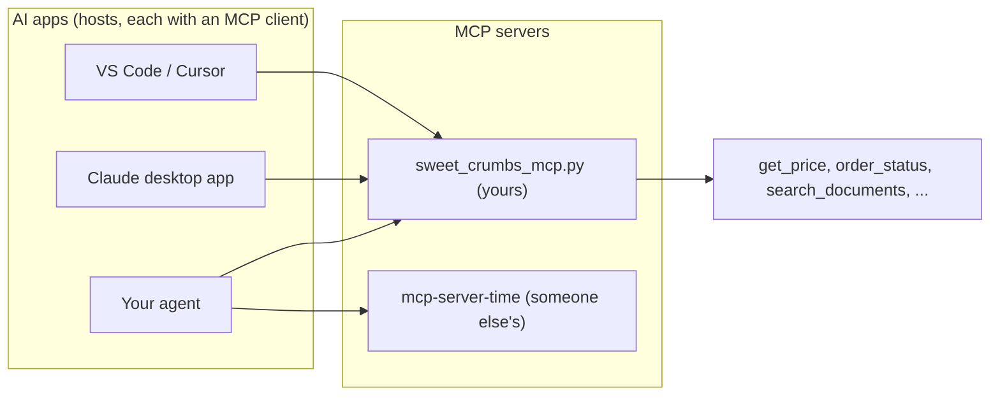

# Lesson 3.8: MCP: Plug Your Agent into Anything

**Course:** Python for AI · **Module 3:** RAG and Tools · **Updated:** Oct 2026

> **By the end:** You can read and write basic `async` / `await` code, build your own **MCP server** that offers the Sweet Crumbs tools to any AI app, test it from the terminal and with pytest, connect it to your own agent next to a server someone else wrote, and plug it into the Claude desktop app. Your tools are no longer locked inside one script.

---

## 1. Mental Model: One Plug for Every AI App

Before USB, every printer, mouse and camera had its own cable. Today one USB-C port takes them all. **MCP (Model Context Protocol)** is that port for AI tools.

Until now, your tools lived inside your Python files: only **your** agent could use them. Wrap them in an **MCP server**, and any MCP app can use them: your agent, the Claude desktop app, code editors like VS Code and Cursor, and the agent a client builds next year. Write the tools once, plug them in everywhere.



| Word | Meaning | In this lesson |
|---|---|---|
| **MCP server** | A program that offers tools (and sometimes data and prompts) in the MCP format | `sweet_crumbs_mcp.py` |
| **Host** | The AI app the user talks to | Your agent, the Claude desktop app |
| **MCP client** | The part of the host that connects to servers | `MCPAdapter` in your agent |
| **Tool** | A function the model can ask to run, with a name, a description and arguments | The same tools as Lesson 2.8 |
| **stdio** | The host starts the server as a program and talks to it through its input and output | Everything on your own computer |
| **HTTP** | The server runs on its own and is reached by a URL | Servers on the internet (the stretch goal) |

MCP servers can offer three things: **tools** (actions the model can call), **resources** (data to read, like files) and **prompts** (ready-made instructions). This lesson uses tools, the most common one.

---

## 2. `async` / `await` Basics

MCP is built on **async** Python, and so are its LangChain tools. Here is the 5-minute version.

A normal function makes Python **wait** while a web API or a model answers. An `async` function lets Python do other work during that wait. A waiter who takes one order, waits by the kitchen until it is cooked, then takes the next order, is normal code. A waiter who takes every order, then serves each dish as it comes out, is async code.

`code/lesson_3_8_async.py`

```python
"""Lesson 3.8: async and await basics. Three slow "API calls", one after another, then all at once."""

import asyncio
import time


def fetch_slow(name: str, seconds: float) -> str:
    """A normal function: Python waits here and does nothing else."""
    time.sleep(seconds)
    return f"{name} done"


async def fetch(name: str, seconds: float) -> str:
    """An async function: while it waits, Python can run other async work."""
    await asyncio.sleep(seconds)  # stands in for a web API or an AI model that takes time to answer
    return f"{name} done"


async def main():
    start = time.time()
    print([fetch_slow("rates", 1), fetch_slow("weather", 1), fetch_slow("documents", 1)])
    print(f"One after another: {time.time() - start:.1f} seconds")

    start = time.time()
    print(await fetch("rates", 1))
    print(f"One await: {time.time() - start:.1f} seconds")

    start = time.time()
    results = await asyncio.gather(fetch("rates", 1), fetch("weather", 1), fetch("documents", 1))
    print(results)
    print(f"All at once with gather: {time.time() - start:.1f} seconds")

    forgot = fetch("rates", 1)  # no await: nothing runs, you only get a "coroutine" object
    print(type(forgot).__name__)
    forgot.close()  # tidy up the coroutine we never ran


asyncio.run(main())  # starts the event loop: the one place a normal script enters async code
```

**Output**
```text
['rates done', 'weather done', 'documents done']
One after another: 3.0 seconds
rates done
One await: 1.0 seconds
['rates done', 'weather done', 'documents done']
All at once with gather: 1.0 seconds
coroutine
```

| Code | Meaning |
|---|---|
| `async def fetch(...)` | An async function. Calling it does **not** run it; it gives you a coroutine (a task waiting to start) |
| `await fetch(...)` | Run it and wait for its result. Only allowed **inside** an `async def` |
| `asyncio.run(main())` | Starts the async world from a normal script. Use it **once**, at the bottom |
| `asyncio.gather(a, b, c)` | Runs several async calls at the same time: 3 waits of 1 second take 1 second, not 3 |
| `asyncio.sleep(1)` | Async waiting. `time.sleep(1)` inside async code would block everything |
| No `await` | Nothing happens; you get a `coroutine` object. Python warns `coroutine ... was never awaited` |

LangChain has an async twin for every call you know:

| Normal (Modules 2 and 3) | Async (this lesson) |
|---|---|
| `llm.invoke(messages)` | `await llm.ainvoke(messages)` |
| `llm.stream(messages)` | `async for chunk in llm.astream(messages)` |
| `tool.invoke(args)` | `await tool.ainvoke(args)` |

**Why you need this now:** tools that come from an MCP server can **only** be called with `await tool.ainvoke(...)`. Calling `tool.invoke(...)` raises `NotImplementedError: StructuredTool does not support sync invocation.`

---

## 3. Build Your MCP Server

### Setup

```bash
uv add "langchain[mcp]"
```

This adds MCP support to LangChain (`langchain.mcp`) and installs **FastMCP**, the most used Python library for building MCP servers. The quotes stop your terminal from reading the square brackets.

### One fix first: logs go to stderr

A stdio server talks to its host through **stdout**, the same place `print()` writes. A stray `print()` in a server is like shouting into a phone line used by two computers: the text is lost, or it breaks the connection. Messages for humans go to **stderr** instead.

In `code/sweet_crumbs/search.py`, add `import sys` at the top, and change the "Built the search index" line:

```python
    # stderr, not stdout: when this runs inside an MCP server, stdout belongs to the protocol
    print(f"(Built the search index {INDEX_FILE.name}: {len(CHUNKS)} chunks in {time.time() - start:.1f} seconds)", file=sys.stderr)
```

In normal scripts, stderr still shows in the terminal, so nothing changes for you.

### `code/sweet_crumbs_mcp.py`

```python
"""The Sweet Crumbs tools offered as an MCP server, for any MCP app: your agent, the Claude desktop app, an IDE.

Run by an MCP client, not by hand. Test it with: uv run fastmcp dev inspector sweet_crumbs_mcp.py
"""

from fastmcp import FastMCP

from sweet_crumbs.data import business
from sweet_crumbs.tools import TOOLS

mcp = FastMCP(business["name"])

# Read-only tools only. place_order is left out: it asks the owner with input(),
# and over MCP the input channel belongs to the protocol, so no human could answer.
READ_ONLY = ["get_price", "order_status", "convert_currency", "get_weather", "search_documents"]
for name in READ_ONLY:
    mcp.tool(TOOLS[name].func)  # .func is the plain Python function inside a LangChain tool, docstring included


@mcp.tool
def business_info() -> str:
    """Get the bakery's name, city, opening hours, delivery terms and menu."""
    menu = ", ".join(f"{item} {price} PKR" for item, price in business["prices"].items())
    return (f"{business['name']}, {business['city']}. Hours: {business['hours']}. "
            f"Delivery: {business['delivery']}. Menu: {menu}.")


if __name__ == "__main__":
    mcp.run(show_banner=False)  # stdio by default: the client starts this file and talks over stdin and stdout
```

| Part | Why |
|---|---|
| `FastMCP(business["name"])` | Creates the server; the name is what hosts show |
| `TOOLS[name].func` | The plain Python function inside each LangChain tool from Lesson 2.8. Same code, same docstring: nothing is copied |
| `mcp.tool(function)` | Registers a function as an MCP tool. FastMCP reads its name, type hints and docstring, exactly as `@tool` did |
| `@mcp.tool` on `business_info` | The decorator form, for a new tool written just for MCP |
| `READ_ONLY` list | Only tools that read. `place_order` stays out (see below) |
| `mcp.run(show_banner=False)` | Starts the server over stdio and skips the welcome banner |

**Why `place_order` is not offered:** it asks the owner `input("Place it? (yes/no)")`. Over stdio, the input channel belongs to the protocol, so no human can answer, and any app that connects could place orders. **Offer read-only tools first.** Actions that cost money need an approval step that a human controls in the host.

---

## 4. Test the Server Before Connecting Anything

You never run an MCP server by hand: a host starts it. To test it, use the `fastmcp` command, which acts as a tiny host.

**List the tools:**
```bash
uv run fastmcp list sweet_crumbs_mcp.py
```
```text
Tools (6)

  get_price(item: str) -> dict
    Get the price of one bakery item in PKR.

  order_status(order_id: str) -> dict
    Check the status of an existing order.

  convert_currency(amount: float, from_currency: str, to_currency: str) -> dict
    Convert an amount of money between currencies, using today's exchange rate.

  get_weather(city: str) -> dict
    Get the current weather in a city, for planning deliveries.

  search_documents(question: str) -> dict
    Search the owner's documents for policies, rules and details: refunds,
delivery, catering, allergies.

Do not use it for prices of menu items or for orders: other tools do that.

  business_info() -> dict
    Get the bakery's name, city, opening hours, delivery terms and menu.
```

**Call one tool:**
```bash
uv run fastmcp call sweet_crumbs_mcp.py get_price item=brownie
```
```text
{
  "result": "brownie costs 300 PKR"
}
```

If these two work, the server is fine, and any later problem is in the host's settings. For a visual tester in the browser, `uv run fastmcp dev inspector sweet_crumbs_mcp.py` opens the official MCP Inspector (it needs Node.js).

### An automatic test: `code/tests/test_mcp_server.py`

`MCPAdapter` can connect to a server **in memory**, with no subprocess, which is perfect for pytest (Lesson 3.7):

```python
"""Tests for the MCP server, connected in memory: no subprocess and no Ollama needed."""

import asyncio

from langchain.mcp import MCPAdapter

from sweet_crumbs_mcp import mcp


async def call(tool_name: str, args: dict) -> str:
    """Connect to the server in memory, call one tool and return its text."""
    async with MCPAdapter(mcp) as adapter:
        tools = {tool.name: tool for tool in await adapter.list_tools()}
    result = await tools[tool_name].ainvoke(args)
    return result[0]["text"]


def test_only_read_only_tools_are_offered():
    async def names():
        async with MCPAdapter(mcp) as adapter:
            return [tool.name for tool in await adapter.list_tools()]

    offered = asyncio.run(names())  # asyncio.run lets a normal test function run async code
    assert "get_price" in offered and "search_documents" in offered
    assert "place_order" not in offered


def test_get_price_works_over_mcp():
    assert asyncio.run(call("get_price", {"item": "Brownie"})) == "brownie costs 300 PKR"


def test_business_info_lists_the_menu():
    assert "cupcake 250 PKR" in asyncio.run(call("business_info", {}))
```

```bash
uv run pytest -m "not ollama"
```
```text
18 passed, 6 deselected, 1 warning in 1.66s
```

The 1 warning is `LangChainBetaWarning: langchain.mcp is in beta`: LangChain added MCP support in version 1.4 (September 2026), and the warning says the API may still change. It is expected.

---

## 5. Connect the Servers to Your Agent

Your agent can use several MCP servers at once. Besides yours, add **`mcp-server-time`**, a free server from the MCP project, so the agent can answer "Are you open now?". You did not write it, and you do not need to read its code: that is the point of MCP.

### `code/mcp_servers.json`

```json
{
  "mcpServers": {
    "sweet_crumbs": {
      "command": "uv",
      "args": ["run", "sweet_crumbs_mcp.py"],
      "env": {"FASTMCP_LOG_LEVEL": "WARNING"}
    },
    "time": {
      "command": "uvx",
      "args": ["mcp-server-time", "--local-timezone", "Asia/Karachi"]
    }
  }
}
```

| Part | Why |
|---|---|
| `"mcpServers"` | The standard shape: the Claude desktop app, Cursor and others use the same format |
| `"command"` and `"args"` | The program the host starts: `uv run sweet_crumbs_mcp.py` |
| `uvx mcp-server-time` | `uvx` downloads and runs a published Python tool in one step (the first run takes a few seconds) |
| `"env"` | Environment variables for that server. Hosts do **not** pass on your terminal's variables by default |
| `FASTMCP_LOG_LEVEL` | Hides the server's "Starting MCP server" info line |

### `code/lesson_3_8_mcp_agent.py`

```python
"""Lesson 3.8: an agent whose tools come from MCP servers: your own, and one written by someone else.

The servers are listed in mcp_servers.json, in the same format the Claude desktop app uses.
Run from the code folder: uv run lesson_3_8_mcp_agent.py
"""

import asyncio
import json
import logging
from pathlib import Path

import httpx

from langchain.chat_models import init_chat_model
from langchain.mcp import MCPAdapter

from sweet_crumbs.config import MAX_STEPS, MODEL, PROVIDER

logging.getLogger("fastmcp").setLevel(logging.WARNING)  # hide the MCP library's info messages

SERVERS = json.loads(Path("mcp_servers.json").read_text(encoding="utf-8"))

SYSTEM = {
    "role": "system",
    "content": "You are the Sweet Crumbs bakery agent in Lahore. Use the tools for prices, orders, live rates "
    "and weather, the owner's documents, business details and the current time. Never guess. "
    "Cite document names in square brackets, like [policies.md]. Answer in at most 3 short sentences.",
}


async def run_agent(llm_with_tools, tools: dict, messages: list) -> str:
    """The Lesson 2.8 agent loop, now async: every model call and every tool call is awaited."""
    for step in range(MAX_STEPS):
        response = await llm_with_tools.ainvoke(messages)
        messages.append(response)
        if not response.tool_calls:
            return response.text

        for call in response.tool_calls:
            if call["name"] not in tools:
                messages.append({"role": "tool", "content": f"Unknown tool: {call['name']}", "tool_call_id": call["id"]})
                continue
            # Passing the whole tool call returns a ready ToolMessage with the right tool_call_id
            result = await tools[call["name"]].ainvoke(call)
            print(f"  [mcp] {call['name']}({call['args']}) -> {' '.join(result.text.split())[:80]}")
            messages.append(result)
    return "Sorry, I could not finish that. A human will help you."


async def main():
    async with MCPAdapter(SERVERS) as adapter:
        tool_list = await adapter.list_tools()  # the servers start, and say which tools they offer
    if len(tool_list) == 0:
        print("No tools found. Check mcp_servers.json and that each server starts on its own.")
        return

    tools = {tool.name: tool for tool in tool_list}
    llm = init_chat_model(MODEL, model_provider=PROVIDER, temperature=0.2)
    llm_with_tools = llm.bind_tools(tool_list)
    print(f"Agent ({MODEL}) with {len(tools)} tools:")
    for name in tools:
        print(f"  {name}")
    # With several servers, every tool name starts with its server's name: a server with no tools did not start
    for server in SERVERS["mcpServers"]:
        if len(SERVERS["mcpServers"]) > 1 and not any(name.startswith(server + "_") for name in tools):
            print(f"  Missing: {server} did not start. Run its command on its own to see the error.")

    messages = [SYSTEM]
    while True:
        text = input("You: ").strip()  # input() pauses everything; fine for a one-person chat
        if text.lower() == "bye":
            break
        if text == "":
            continue
        messages.append({"role": "user", "content": text})
        try:
            answer = await run_agent(llm_with_tools, tools, messages)
        except (httpx.ConnectError, ConnectionError):
            print("Agent: Cannot reach Ollama. Is it running?")
            messages.pop()
            continue
        print(f"Agent: {answer}")


asyncio.run(main())
```

**Run**
```bash
uv run lesson_3_8_mcp_agent.py
```

**Example (a real model's wording will differ)**
```text
Agent (llama3.2) with 8 tools:
  sweet_crumbs_get_price
  sweet_crumbs_order_status
  sweet_crumbs_convert_currency
  sweet_crumbs_get_weather
  sweet_crumbs_search_documents
  sweet_crumbs_business_info
  time_get_current_time
  time_convert_time
You: How much is a brownie?
  [mcp] sweet_crumbs_get_price({'item': 'brownie'}) -> brownie costs 300 PKR
Agent: A brownie costs 300 PKR.
You: Can I get my money back if my cake is late?
  [mcp] sweet_crumbs_search_documents({'question': 'Can I get my money back if my cake is late?'}) -> [policies.md] # Sweet Crumbs Policies ## Opening hours We are open 9 am to 10 pm
Agent: Yes. If your order is late by more than 1 hour, call within 24 hours for a full refund or a free replacement [policies.md].
You: Are you open now?
  [mcp] time_get_current_time({'timezone': 'Asia/Karachi'}) -> { "timezone": "Asia/Karachi", "datetime": "2026-10-26T16:09:35+05:00", "day_of_w
Agent: It is 4:09 pm on Monday in Lahore, and we are open 9 am to 10 pm, so yes, we are open.
You: bye
```

| Part | Why |
|---|---|
| `async with MCPAdapter(SERVERS) as adapter:` | Starts the servers and connects; `async with` closes the connection at the end of the block |
| `await adapter.list_tools()` | Asks every server for its tools; they come back as LangChain tools |
| Tools still work after the `async with` | Each tool reconnects for its own call, so they can be used anywhere later |
| `sweet_crumbs_get_price` | With several servers, each tool name starts with its server's name, so two servers can both have a `search` tool |
| `bind_tools(tool_list)` | The same `bind_tools` as Lesson 2.8: MCP tools are ordinary LangChain tools to the model |
| `await llm_with_tools.ainvoke(...)` | The Lesson 2.8 loop, with `await` on every model call |
| `await tools[name].ainvoke(call)` | Passing the **whole** tool call returns a ready `ToolMessage` with the right `tool_call_id` |
| `result.text` | The tool's text. MCP results arrive as a list of content blocks; `.text` joins them |
| "Missing: ... did not start" | A server that fails is **skipped**, and the others keep working. Say so instead of failing quietly |
| `input()` inside `async def main()` | It pauses everything, which is fine for a chat with one person |

The agent never imports `sweet_crumbs.tools`. Its tools come from the servers, so the same agent works with servers in any language, on any computer.

---

## 6. Connect Your Server to the Claude Desktop App

The same server, with no code changes, can give the Claude desktop app access to the owner's prices and documents.

**Step 1: find two full paths.** The app starts your server from its own folder, so relative paths and your terminal's `PATH` do not work.

| | macOS | Windows |
|---|---|---|
| Where `uv` is | `which uv` | `where uv` |
| Your project folder | `pwd` in the project root | `cd` in the project root |

**Step 2: open the config file.** In the Claude desktop app: **Settings, Developer, Edit Config**. That opens `claude_desktop_config.json`:

- macOS: `~/Library/Application Support/Claude/claude_desktop_config.json`
- Windows: `%APPDATA%\Claude\claude_desktop_config.json`

**Step 3: add the server** (with your own paths; on Windows, write each `\` as `\\` inside JSON):

```text
{
  "mcpServers": {
    "sweet-crumbs": {
      "command": "/Users/you/.local/bin/uv",
      "args": [
        "run",
        "--project", "/Users/you/python-ai",
        "/Users/you/python-ai/code/sweet_crumbs_mcp.py"
      ]
    }
  }
}
```

| Part | Why |
|---|---|
| Full path to `uv` | The app does not see your terminal's `PATH` |
| `--project` | Tells `uv run` which project's packages to use, wherever the app starts it |
| Full path to the server file | The app starts in its own folder, not in `code/` |

`fastmcp install claude-desktop sweet_crumbs_mcp.py --project ..` can write this entry for you, but write it once by hand first so you understand it.

**Step 4: restart properly.** Quit the app completely (not just the window) and open it again.

**Step 5: check.** Click **+** under the chat box, then **Connectors**: `sweet-crumbs` should be listed with its tools. Ask: "What is the Sweet Crumbs refund policy?" The app asks your permission the first time it uses a tool.

**If it does not appear:** run the exact `command` and `args` in a terminal from your home folder. If it fails there, fix that first. The server's log (`mcp-server-sweet-crumbs.log`) is linked from the Developer settings.

**Privacy check:** your server runs on your computer, but the Claude desktop app uses a cloud model. When it calls `search_documents`, the matching chunks of the owner's documents are sent to that model. Ask the owner first, as in Lesson 1.2.

---

## 7. Common Errors and Traps

| Problem | Cause | Fix |
|---|---|---|
| `NotImplementedError: StructuredTool does not support sync invocation.` | Called an MCP tool with `.invoke` | `await tool.ainvoke(...)` inside an `async def` |
| `SyntaxError: 'await' outside async function` | `await` in a normal function | Put it inside `async def`, and start with `asyncio.run(main())` |
| `RuntimeWarning: coroutine 'main' was never awaited` | Called `main()` instead of running it | `asyncio.run(main())` |
| Nothing happens, and you get a `coroutine` object | Forgot `await` | `result = await fetch(...)` |
| `RuntimeError: asyncio.run() cannot be called from a running event loop` | Used `asyncio.run` inside a notebook or inside async code | In Jupyter, write `await main()` directly |
| `print()` text from the server never appears | stdout belongs to the protocol | `print(..., file=sys.stderr)` |
| `Failed to connect to MCP server 'sweet_crumbs', skipping` | The command or path is wrong, or the server crashes on start | Run the command on its own; check with `fastmcp list` |
| `error: Failed to spawn: sweet_crumbs_mpc.py` | A typo in the file name | Check the `args` in `mcp_servers.json` |
| `KeyError: 'get_price'` in your agent | With several servers, names have a prefix | Use the names from `list_tools()`, like `sweet_crumbs_get_price` |
| A setting from `.env` or your terminal is missing in the server | Hosts do not pass environment variables on | Load `.env` in `config.py` (done), or add `"env"` in the config |
| Claude desktop: server missing or `spawn uv ENOENT` | The app cannot find `uv` | Full path from `which uv` / `where uv`, then quit and reopen the app |
| Claude desktop: the JSON change does nothing | Invalid JSON (a missing comma) or the app was not fully restarted | Check the JSON, then quit the app completely |
| A client can place orders through your server | An action tool offered without approval | Offer read-only tools; keep approvals in the host |
| `LangChainBetaWarning: langchain.mcp is in beta` | Expected: the API is new | Nothing to fix; check the release notes when you upgrade |

---

## 8. Job & Client Angle

- **MCP is how AI apps connect to business systems.** Clients ask for "Claude (or ChatGPT, or our own agent) connected to our data". An MCP server is that connection, built once and reused in every app they use.
- **A new kind of freelance product:** "an MCP server for your shop's prices, stock and policies" that the owner's staff use inside the Claude desktop app, with no new website or chat window to build.
- **Reuse beats rebuilding.** Before writing a tool, check if a trusted MCP server exists (time, files, calendars, databases). Your value is choosing, connecting and testing them.
- **Security is part of the job.** An MCP server runs on the computer with that user's permissions. Install only servers you trust, offer read-only tools first, never put keys in `mcp_servers.json` that goes to GitHub, and tell the client exactly what each tool can do.
- **Portfolio proof:** a short screen recording of the same server answering in your agent **and** in the Claude desktop app shows you understand the 2026 agent stack.

---

## 9. Your Task (self-create)

Offer **your own** business tools as an MCP server: read-only tools from your Lesson 2.8 package plus one new MCP-only tool, tested with `fastmcp list`, `fastmcp call` and in-memory pytest tests, connected to an async agent together with a server you did not write, and connected to the Claude desktop app.

**Full requirements, expected output, stretch goal and marking:** [Task 3.8: Business MCP Server](../assessments/module-3/checkpoint-2-code-tasks.md#task-38-business-mcp-server)

Run `uv run fastmcp list sweet_crumbs_mcp.py` and `uv run lesson_3_8_mcp_agent.py` from the `code` folder, then push (without private documents or `indexes/`).

**Checkpoint 2 reached (Lessons 3.5 to 3.8).** Your agent searches the owner's documents by meaning, answers with sources, is measured with tests and evals, and offers its tools to any AI app through MCP.

---

## Key Takeaways

- `async def` defines async work, `await` runs it, `asyncio.run(main())` starts it once, and `asyncio.gather` runs several waits at the same time
- **MCP** is one standard plug between AI apps (hosts) and tools (servers); write the tools once, use them everywhere
- FastMCP turns your existing functions into an MCP server; over stdio, never `print()` to stdout
- `MCPAdapter` connects your agent to one or many servers; MCP tools are normal LangChain tools, called with `await tool.ainvoke(...)`
- Offer read-only tools first, test with `fastmcp list` and `fastmcp call`, and use full paths for desktop apps

### Quick Check
1. What is the difference between `fetch("rates", 1)` and `await fetch("rates", 1)`?
2. Why must a stdio MCP server never `print()` to stdout, and where should its messages go instead?
3. Why does your server offer `get_price` and `search_documents`, but not `place_order`?

---

## Must-Have Resources

- Model Context Protocol, official site and specification: https://modelcontextprotocol.io
- FastMCP, getting started: https://gofastmcp.com/getting-started/welcome
- LangChain MCP (`MCPAdapter`): https://docs.langchain.com/oss/python/langchain/mcp
- Python `asyncio`: https://docs.python.org/3/library/asyncio.html
- MCP reference servers (including `mcp-server-time`): https://github.com/modelcontextprotocol/servers

**Next:** Module 3, Checkpoint 2 Project
